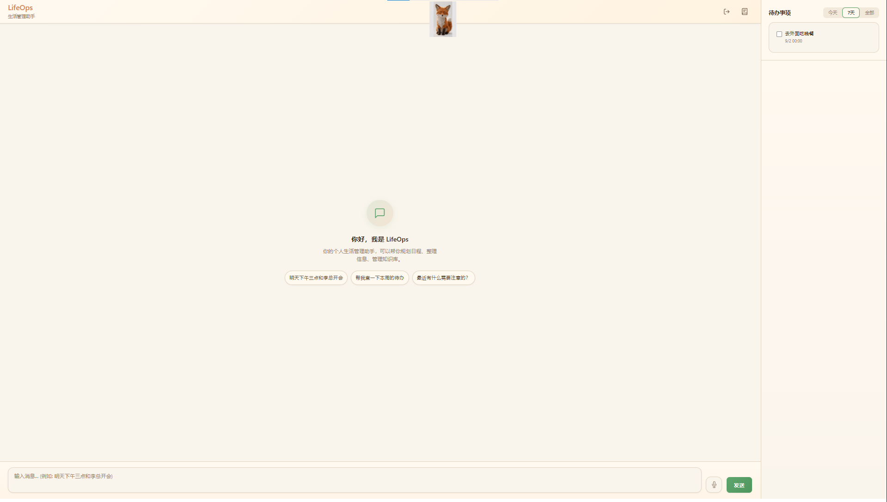
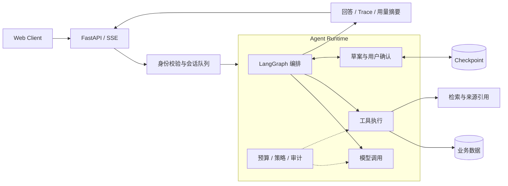

<div align="center">

# LifeOps-Agent

### 面向个人事务管理的 AI Agent

自然语言交互 · 多步任务编排 · 人机确认 · 可追溯执行

**FastAPI · LangGraph · SQLite · Qwen · Docker**

[快速开始](#快速开始) · [系统架构](#系统架构) · [测试与评估](#测试与评估) · [部署与持续集成](#部署与持续集成) · [Harness 源码](app/src/common/harness/)

</div>

---

LifeOps-Agent 将待办、记账、日历和知识库整合到统一的对话入口。模型负责理解请求与生成计划，应用负责执行约束、用户确认和数据持久化，通过 SSE 展示处理进度、回答、来源引用与执行轨迹。

项目同时提供真实模型模式与无需 API Key 的离线演示，涵盖 Agent 编排、运行时控制、回归评估和容器化部署。



## 核心能力

| 能力 | 实现方式 |
| --- | --- |
| **任务编排** | LangGraph 管理多轮状态、JSON 动作路由、多步计划、执行验证与结果汇总 |
| **人机确认** | 待办先生成草案，通过 checkpoint 支持确认、修改和取消；已有账户余额变更须确认 |
| **知识库问答** | BM25 / 向量 / 混合检索，支持 RRF 融合、可选重排和来源引用 |
| **个人记忆** | 保留聊天原文，增量生成摘要，按身份隔离画像、事件与学习文件 |
| **运行控制** | 独立 Harness 管理时间、调用次数和 token 预算，拦截工具请求并记录审计 |
| **工具契约** | 统一注册参数 schema、副作用与确认要求，模型工具目录与执行校验同源，参数拒绝后停止后续计划 |
| **交互与工具** | SSE 流式交互、请求取消、待办、收支、日历、天气与可选本地语音 |

## 系统架构



### 编排与确认

路由层将请求转换为 `{action, args}`，复杂任务生成多步计划，由程序分派工具并汇总执行结果。同一会话通过进程内 FIFO 队列串行处理，降低并发请求覆盖 checkpoint 的风险。

队列默认最多接收全进程 32 个任务、单会话 8 个任务（均包含运行中与排队中）。超限通过 SSE `error` 返回可重试提示，不启动该任务；空闲会话自动释放队列与 worker。关闭服务时停止接收新任务，默认排空 15 秒，随后取消剩余任务并等待工具退出，再关闭 checkpoint；这些容量限制仅对单进程有效。

主动停止会把原问题、计划进度、未完成输出和已提交操作回执存入业务库。下一条补充条件会携带这份中断上下文供模型重新规划；原请求重试返回已中止结果。停止不会撤销已提交写入，也不保证恢复模型内部推理。

待办使用 LangGraph `interrupt()` 暂停执行，保存草案后等待用户操作：

```text
描述任务 → 生成草案 → 用户修改 / 确认 / 取消 → 恢复执行 → 返回结果
```

确认后写入待办，取消则结束该流程。已有账户余额变更也需要确认；收支记录等操作遵循各自业务规则。

### 运行时 Harness

Harness 独立于模型可修改的图状态，对模型与工具调用施加统一约束：

- **预算控制**：限制墙钟时间、LLM / 工具调用次数、token 和图超级步数。
- **工具策略**：动作白名单、只读 SQL 校验、会话作用域视图与 SQLite authorizer。
- **参数边界**：[统一工具契约](app/src/domain/tool_registry.py)生成模型可见目录，校验金额、日期、枚举、查询上限及未知字段；身份由服务端注入，内部确认动作不对模型开放。
- **执行失败**：工具异常返回结构化 `tool_error` 并停止后续计划，区分业务拒绝、模型/存储/依赖故障。工具调用和整轮状态不再把这些异常记为成功，响应不包含底层异常原文。
- **可观测性**：记录耗时、用量来源、异常和预算状态，输出 `harness_summary` 与元数据审计。
- **前后台隔离**：学习、记忆和文档摘要使用独立预算；等待用户确认不占用执行时间。

供应商返回 usage 时记录实际用量，缺失时标记并采用保守预留量控制预算。详细实现见 [Harness 模块](app/src/common/harness/)。

多步任务不是跨工具的总事务。失败结果用 `outcome` 区分未完成、当前操作未应用、已有操作回执提交和写入结果不确定，并保留前序步骤进度。已提交写入不会因后续失败自动撤销；结果不确定时先查询记录，不能盲目再次写入。已收到最终失败响应的请求会保存原结果，不自动重新执行业务；未确认的传输/请求失败只有在提供原 `request_id` 时才允许重试确认。失效草案和请求标识冲突属于终结拒绝，前端不再显示原请求重试，并仅清理对应失效草案。

### 数据库升级

业务 SQLite 库启动时使用 `business_schema_revisions` 记录迁移版本，以 `BEGIN IMMEDIATE` 串行执行升级；结构变更与版本记录同事务提交，失败整体回滚。首次升级兼容历史支持的缺失字段并保留记录；发现未知版本、版本链不一致或缺少当前模型必需的表/字段时拒绝启动。未来业务结构变化需追加迁移版本。知识库使用独立的 `knowledge_schema_revisions`，其表结构与 FTS 初始化同事务升级，并检查索引版本及必要触发器。此机制尚不覆盖 LangGraph 自身的 schema，也不自动降级数据库；升级前应停止服务并创建已校验的离线快照，回退时恢复快照与配套代码。

### 索引修复

索引损坏时，可在停止所有写入进程后运行 `python -m scripts.rebuild_lexical_index /data/knowledge.db --output /data/knowledge-repaired.db --service-stopped`。命令从持久化 chunk 重建 FTS 到新数据库，不覆盖源库或已有目标；未知 schema/索引版本会拒绝修复。检查新库检索结果后，再在停机状态切换 `KNOWLEDGE_DATABASE_URL`，保留原库用于核对。此命令只修复派生词法索引，不修复损坏的原始 chunk 或向量索引。

### 请求恢复

请求重试用于确认原结果，不等于让模型重新做一次。业务库的执行认领表在图启动前原子认领同一请求；尚未认领的准备记录可以继续，已认领的记录不再重新规划。旧库中没有认领记录的未完成请求按状态不明处理，不能据此重跑。

图返回后，完整响应先暂存在 checkpoint 数据库的独立结果表中，再将业务请求回执与助手消息同事务保存。若最后一步失败，重试可取回暂存的原响应，成功后清理冗余暂存；若业务提交成功但确认返回失败，则读取原回执，不重复追加助手消息。暂存不可用但业务响应仍能保存时，请求可以正常结束。

两份响应均不可用时，只有同时满足请求键、身份、消息 ID 匹配且图已完整结束，才允许从 checkpoint 恢复已有回答，并标记运行元数据不完整。待确认、尚有节点未运行或绑定不匹配的 checkpoint 不作为完成证明；无法证明结果的请求返回 `request_outcome_unconfirmed`，拒绝自动重新执行，需先核对记录再发起明确的新操作。这个恢复协议不将多步任务变成跨库事务，也不提供跨进程的会话并发协调。

主动停止也会记录取消结果或执行认领标记，防止模型启动前被停止的请求后来重试执行；若完整结果已经先保存，则保留该原结果，停止输出不会撤销业务操作。持久化依赖存储可用，不能持久确认停止时会返回不确定状态。

### 检索与记忆

默认 BM25 无需向量模型；可选混合链路采用 **BM25 + 向量召回 → RRF 融合 → 交叉编码器重排**，保留文档路径、页码和章节信息，供回答引用。

关键词检索使用现有 SQLite 数据库中的 **FTS5 持久化索引**，沿用中文相邻双字、英文连续字符的分词规则。文档变更通过数据库触发器记录待更新项，在入库后及查询前分批同步；查询只加载命中的候选原文，不在 Python 中保存全量 chunk 或构建全量 BM25 对象。已有知识库首次检索会自动补建索引，需要 SQLite 运行时支持 FTS5。

FTS5 按全库词频统计计算 BM25，再应用文档摘要相关性筛选，分数与原 `rank_bm25` 实现不直接可比；界面相关度是词面匹配的展示分，不代表回答正确率。个人状态问题不再按文档类型排除指南、菜谱或论文，重排与真实问题的检索质量仍需独立评估。

所有知识库片段均标为参考材料：文件名含“个人日志”或正文使用第一人称，都不证明它属于当前用户。个性化 RAG 另行读取当前身份最近最多 20 条用户原话（排除助手回答、本轮消息和未来消息，总计最多 6000 字符），保留 UTC 记录时间，并接收本轮已完成的相关查询结果。参考上下文同样设有长度上限，优先保留命中片段并标明截断，防止大段历史挤占回答预算。模型须区分自述、假设、否定、计划和已发生行为；指南可用于评价用户的自述，不能用来填补其实际经历。该通道只覆盖有限的近期历史，较早信息仍需查询或澄清；这些输入约束和提示规则不能替代真实模型的事实归属评估。

参考知识库目前按实例共享；文件类型和来源标签不提供用户归属或访问权限控制。

原始对话持续留存，摘要按游标增量更新。个人画像、事件和学习文件按身份隔离，并为历史内容附加时间信息，帮助模型区分背景记录与当前安排。

## 快速开始

### Docker 演示

在已启动 Docker 的环境中，于仓库根目录执行：

```bash
docker compose up -d --build
```

访问 **http://127.0.0.1:5001**，使用 `demo` / `lifeops-demo-2026` 登录。

> 演示使用规则模拟模型、BM25 和仓库内虚构资料，无需 API Key 或模型下载；HTTP/SSE、图执行、身份校验和数据库操作均实际运行。语音与后台学习默认关闭，天气使用虚构数据。

| 体验步骤 | 输入示例 | 观察结果 |
| --- | --- | --- |
| 创建草案 | `明天下午3点开会` | 展示草案，尚未写入待办 |
| 修改安排 | `可以改成后天吗` | 更新草案日期 |
| 确认或取消 | `确认` / `取消` | 写入待办或结束流程 |
| 查询结果 | `查询待办` | 查看当前待办 |
| 知识库问答 | `报销需要哪些材料` | 回答附带虚构制度来源 |

```bash
# 验证部署后的 HTTP/SSE、确认流程、引用与执行摘要
docker compose exec -T lifeops-demo python scripts/smoke.py --url http://127.0.0.1:5000

# 停止服务，保留数据卷
docker compose down
```

演示数据使用专用 volume。如需切换构建源，可设置 `PIP_INDEX_URL`；演示端口通过 `LIFEOPS_PORT` 配置。Windows Docker Desktop 可按本机环境显式指定 `docker --context desktop-linux compose ...`。

### 真实模型模式

建议使用 Python **3.11**。Windows PowerShell 示例：

```powershell
python -m venv .venv
.\.venv\Scripts\Activate.ps1
python -m pip install -r requirements-core.txt
Copy-Item app/src/common/env/.env.example app/src/common/env/.env
```

知识库索引同一进程一次只允许一个构建任务；重叠请求返回 HTTP 409，文档超限返回 HTTP 422。未知索引异常返回安全的 HTTP 500 提示，不能据此认定所有阶段都未提交；向量构建失败而 SQLite 已成功时，结果明确标记 `indexing_status=degraded` 和固定错误码 `vector_index_build_failed`，表示仅完成部分索引。向量召回结果在进入答案证据前，会按 chunk ID、路径、页码和文本与当前 SQLite 记录核验，丢弃旧索引中的已删除或已改写片段，并使用当前来源元数据；纯向量模式无有效命中时回退到词法检索。此校验可阻止过期片段进入本次候选，但不能补回旧向量索引遗漏的新文档，向量索引仍需重建。FAISS 构建先写入独立 `generations/<版本>/`，两个文件完成后原子替换 `current.json` 指针；加载器读取同一版本，兼容旧的根目录双文件布局。保存或发布失败时不覆盖上一版本，空知识库发布独立空版本。历史版本与未发布目录暂时保留，需停服确认当前指针后按运维策略清理；此机制不等同于断电耐久性或多进程构建协调。后台摘要任务运行或等待期间的重复调度会合并成一次后续扫描，当前任务结束后自动补跑；每轮仍受后台预算和最多100份候选文档限制，超出预算的剩余摘要延期至后续索引。摘要写回前核对文档版本与输入切片，丢弃已过时的生成结果。并发保护适用于当前单进程部署，多进程部署仍需共享任务协调。

知识库导入逐份解析文档。可通过环境变量设置单文件边界：`INGEST_MAX_FILE_BYTES`（默认 20 MiB）、`INGEST_MAX_TEXT_CHARS`（200 万字符）、`INGEST_MAX_PDF_PAGES`（500 页）、`INGEST_MAX_IMAGE_PIXELS`（400 万原图像素，预处理会放大两倍）及 `INGEST_OCR_TIMEOUT_SECONDS`（60 秒）。以上值必须大于零；超限拒绝文档并回滚该批 SQLite 导入，避免静默截断内容。限制不等同于解析进程的硬内存或 CPU 配额，复杂 PDF 仍可能在单页解析内部消耗较多资源。

编辑 `.env`，设置 `QWEN_API_KEY`、实际 `DOCS_DIR`，并保持 `DEMO_MODE=false`、`DEMO_SEED=false`。按需修改 `QWEN_MODEL` 与 `BASE_URL`，随后启动：

```powershell
python -m app.src
```

访问 http://localhost:5000。首次注册须从服务本机回环地址访问，并设置至少 8 位密码；后续使用同一账号登录。身份由 HttpOnly Cookie 校验。

可选向量检索与语音依赖位于 `requirements-ml.txt`，需要另外准备模型；PNG OCR 还需 Tesseract。完整配置见[环境变量模板](app/src/common/env/.env.example)。

## 测试与评估

### 统一验证与迭代对比

已有测试镜像可运行 `python -m scripts.verify_container --image lifeops-agent:test --output artifacts/container-verification`。入口使用独立无网络容器和可保留报告卷，容器结束后导出报告、日志与退出状态，再清理自建容器和匿名卷；输出目录必须为空。此命令验证指定镜像，不会自动重建，因此应先构建与目标源码对应的镜像。

离线验证统一入口为 `python -m scripts.verify --output artifacts/verification`。它依次执行静态检查、单元测试、模拟 E2E、跨进程恢复和参考检索评测；单项失败后继续收集其他检查结果，最终以非零状态报告失败。每次运行必须使用空输出目录，避免旧报告混入。各项日志及增量汇总 `verification.json` 会保留，`complete=false` 表示验证尚未完整结束。GitHub Actions 与 Jenkins 已配置此入口；CI 实际运行结果需以对应构建记录为准。

评测迭代可运行 `python -m app.eval.compare artifacts/baseline.json artifacts/candidate.json --output artifacts/comparison.json`，比较两份 E2E 报告的逐案例结果。命令要求模式、模型、语料、检索后端、案例内容指纹及案例 ID 集合一致，输出退步、改善和仍失败的案例；有成功转失败时返回非零退出码。比较仅证明对应案例的结果变化，不代表真实模型统计准确率；案例指纹覆盖问题及预期结果；修改案例含义后应建立新基线，旧版缺少指纹的报告需重新生成。

### 应用内并发演练

运行 `python -m scripts.load_drill --requests 32 --concurrency 8 --output artifacts/load-drill.json`。工具在独立子进程、临时数据库和离线演示模式下运行；每个操作包含记账 SSE、相同请求重放和 readiness 检查，并按用户核对数据库写入数是否等于唯一请求数。报告包含成功/失败数、P50/P95/最大延迟、健康检查延迟和运行前后源码指纹；失败时非零退出。请求数限定1至200，并发数1至16。

2026-10-31 Windows 本地实测：8并发、32个操作全部成功，写入数量与各用户唯一请求数一致，源码未变化；整组操作 P95约2.36秒，readiness最长约51毫秒。报告在本地 `artifacts/load-drill-c8.json`。使用进程内 ASGI 测试客户端，不经过 TCP、反向代理或生产 ASGI 服务器，也不包含真实模型延迟；这些数字用于本地回归比较，不是生产容量承诺或SLO。

增加 `--transport tcp` 可通过随机回环端口和临时 Uvicorn 服务运行同一工作负载，结束后关闭服务；默认 `--transport asgi` 保留进程内模式。2026-10-31 Windows 本地 TCP 实测：8并发、32个操作全部成功，各用户写入数与唯一请求数一致，源码指纹未变化；整组操作 P95约2.90秒，readiness最长约52毫秒。本地报告 `artifacts/load-drill-tcp-c8.json`。该模式验证真实 HTTP 连接与服务器链路，仍采用离线演示响应，不包含真实模型、反向代理、容器资源配额或长时间稳定性，不能据此承诺生产容量。

### 已有验证证据

2026-10-31 完整离线验收（源码提交 `3ebba8e`）：Windows 本地兼容依赖环境运行统一验证，**586 项单元与回归测试通过、1 项跳过，100/100 条模拟端到端流程、14 个跨进程恢复检查点、静态检查与参考检索评测均通过**，前端另有 **19 项测试通过**。统一报告 `complete=true, passed=true, source_unchanged=true`，源码指纹为 `cb4ac283a99b850f8af2de1a70f8e7f48cb5caaa292498747238ead1f7ea3b88`；报告和日志保存在本地 `artifacts/verification-3ebba8e/`。本轮包含真实 FAISS 本地确定性向量集成，覆盖逐份导入、资源边界、并发准入、摘要一致性、向量版本发布和过期证据拦截；仍有依赖弃用等警告。未更新现有部署，不代表真实模型质量、生产负载或远程 CI 验收。

2026-10-31 本地真实 FAISS 集成验证：Windows 中文用户路径下使用 `faiss-cpu 1.14.3`、`langchain-community 0.4.2`、`langchain-core 1.4.9`，通过真实索引保存、加载、召回、过期缓存候选拦截、重建及空库发布；连同版本发布故障测试共10项通过。测试使用确定性本地向量，不下载模型、不调用付费接口，不衡量 embedding 语义质量。可选依赖齐备时运行 `python -m pytest tests/test_vector_integration.py tests/test_vector_publication.py -q`；核心依赖环境会跳过真实 FAISS 集成用例。索引二进制通过 Python 文件句柄与 FAISS 回调读写，兼容 Windows 中文路径；pickle 元数据仍要求来自可信本地构建，不应加载外部提供的索引包。

2026-10-31 Windows 离线验证（源码基于 `cd75e08`）：首次完整运行发现一项旧测试仍要求个人事件分类为任意文本，与新增分类校验冲突，报告如实保留失败状态。同步该契约测试后，完整单元与回归测试 **553 项通过、1 项跳过**；静态检查通过。首次运行中的 **100/100 条模拟流程契约、14 个跨进程恢复检查点、参考检索门槛**均通过；前端 **19 项测试通过**。详细报告保留在本地 `artifacts/verification-cd75e08/`，其中完整汇总对应修复前的失败运行，修复后的单元测试另存为 `unit-after-contract-fix.xml` 和日志。使用本地兼容依赖路径；这些结果不代表真实模型质量、生产负载或部署验收。

2026-10-30 Linux 测试镜像补充：源码基于 `d4678f5`，新构建测试镜像 `13ca36b70cd4` 在无外部网络、只读根文件系统下执行统一验证入口，静态检查、单元测试、模拟 E2E、恢复演练与检索评测均执行完成，最终退出码为 0。本轮详细报告位于临时内存文件系统，容器结束后未能导出，因此不新增具体测试数量声明；不等同于远程 CI 构建记录。

2026-10-30 容器验收补充：提交 `d4678f5` 已重新构建 production 镜像（镜像配置 ID `8e1de1fddfd9`），在非 root、只读根文件系统、无外部网络及临时数据目录下通过真实 HTTP/SSE 冒烟，包括登录、待办取消与确认、原确认请求重放只写一次、RAG 引用和 Harness 摘要。因原 PyPI TLS 失败，构建使用项目支持的清华 HTTPS 镜像源。该验证未更新既有部署，不涵盖 kind、负载或真实模型质量。

以下为 **2026-10-27** 的验证快照：

| 验证层级 | 结果 | 覆盖范围 |
| --- | --- | --- |
| 单元与回归测试 | **285 项通过** | 编排、业务、认证、隔离、预算与日期处理 |
| 端到端流程契约 | **100 / 100 通过** | HTTP/SSE、图、checkpoint 与隔离 SQLite |
| Docker Compose | **冒烟通过** | 就绪、登录、确认/取消、来源引用与执行摘要 |
| kind | **部署及冒烟通过** | 独立命名空间、单副本、PVC 与实际 HTTP 流程 |

2026-10-29 补充验证：当前源码在 Linux 测试容器中 **454 项单元与回归测试、100/100 条模拟端到端流程契约通过**；前端此前 **16 项测试通过**，跨进程恢复及关联演练 **14 个检查点通过**。覆盖 FTS5、工具参数与执行失败、部分写入结果、失效确认、队列容量、请求幂等、响应保存失败后的恢复、数据恢复、请求关联、监控鉴权和个性化 RAG 的输入边界。本次使用已有测试镜像只读挂载源码，未重建或更新运行中的 Docker / kind 部署。

[查看流程报告](app/eval/reports/e2e-contract.md) · [查看逐例结果与源码指纹](app/eval/reports/e2e-contract.json)

2026-10-30 本地 Windows 完整离线验证（源码基于 8d5e055）：静态检查、488 项测试（另 1 项跳过）、100/100 条模拟流程契约、14 个跨进程恢复检查点及参考检索评测全部通过，统一报告 `complete=true, passed=true`。该轮覆盖日志脱敏、模型截断处理和完整计划预检。使用本地兼容依赖路径运行，未更新 Docker / kind 部署，未测量真实模型质量。

流程契约使用模拟模型，包含 10 类场景各 10 个变体，覆盖确认、取消、修改、多日期、记账、账户变更、引用、权限拦截、预算耗尽和供应商故障。**通过率反映程序契约，不代表真实模型准确率；报告延迟也不代表线上网络或模型性能。**

另有使用[仓库内虚构语料](examples/reference_eval/)和[人工相关性标签](app/eval/reference_cases.json)的 BM25 开发基准，无需 API Key 或外部个人资料：

```bash
python -m app.eval.run_reference --output artifacts/reference-eval.json
```

开发集包含 15 个有相关文档的问题、2 个库外问题和 5 份资料；本次结果为文档 Recall@1 **0.90**、Recall@5 **1.00**，两个库外问题均返回空结果。CI 门槛为 Recall@5 至少 0.80 且库外问题无结果。报告记录语料与源码哈希。指标版本 2 将 Recall（相关文档覆盖比例）与 HitRate（是否至少命中一篇）分开，按文件去重；不能与旧版同名 Recall 直接比较。这是合成开发集，不是保留集，也不评估生成答案或真实用户问题质量；向量、混合检索与重排的消融仍待完成。

```bash
# 在隔离 Linux 镜像中复跑
docker build --target test -t lifeops-agent:test .
docker run --rm lifeops-agent:test
docker run --rm lifeops-agent:test python -m app.eval.run_e2e
```

真实模型回归须配置 Key 并显式启用付费调用：

```bash
python -m app.eval.run_e2e --mode real --allow-paid-calls --output artifacts/e2e-real.json
```

真实模式运行 80 条流程用例，排除模拟故障与模拟跨用户 SQL 的专用场景。真实模型保留集与组件消融评估仍待补充。原有[检索报告](app/eval/reports/retrieval.md)和[路由报告](app/eval/reports/task.json)依赖外部语料，作为历史记录保留。

## 部署与持续集成

| 组件 | 配置入口 | 说明 |
| --- | --- | --- |
| Docker | [Dockerfile](Dockerfile) | 多阶段构建，区分运行、测试与可选 ML 目标，非 root 用户运行 |
| Compose | [compose.yaml](compose.yaml) | 独立数据卷、只读根文件系统、本地回环端口与健康检查 |
| Kubernetes | [kind 配置](deploy/kind/demo.yaml) | 单副本 Deployment、Service、PVC 与探针 |
| Jenkins | [Jenkinsfile](Jenkinsfile) | 构建、检查、测试、报告归档、冒烟与可选 kind 部署 |
| GitHub Actions | [ci.yml](.github/workflows/ci.yml) | 容器验证与报告归档 |

Docker / kind 已完成本地验证。流水线配置已提供，Jenkins 执行节点仍需接入；可选 ML 镜像目标需单独验证。kind 使用已有 `dev` 集群和独立的 `lifeops-demo` 命名空间；Jenkins 需要具备 Docker CLI 与 daemon 访问权限的 Linux 执行节点。

## 运行诊断

每个 HTTP 请求返回服务端生成的 `X-Trace-ID`，结构化请求日志记录该标识、路由模板、状态码和完整响应耗时（包含 SSE 流和排队时间）。Agent 审计与 `harness_summary` 同时携带 HTTP 标识、`turn_id` 和哈希化的请求回执键。重试有新的 HTTP 标识，但复用原回执；缓存回答里的执行轨迹仍属于最初那次执行。

设置独立的 `OPS_METRICS_TOKEN` 后，可通过 Bearer 认证读取 Prometheus 文本格式指标；默认未配置时 `/metrics` 返回 404。Compose 会从同名环境变量传入令牌。普通用户登录 Cookie 不授予监控权限。

```bash
curl -H "Authorization: Bearer $OPS_METRICS_TOKEN" http://127.0.0.1:5001/metrics
```

| 指标 | 用途 |
| --- | --- |
| `lifeops_http_requests_total` / `lifeops_http_request_duration_seconds` | HTTP 状态和完整响应耗时分布，按路由模板聚合 |
| `lifeops_chat_active_jobs` / `lifeops_chat_pending_jobs` / `lifeops_chat_capacity` | 运行中、排队中任务及容量 |
| `lifeops_chat_rejections_total` / `lifeops_chat_queue_wait_seconds` | 全局容量、会话容量、停机拒绝，以及入队等待分布 |
| `lifeops_chat_jobs_total` / `lifeops_agent_turns_total` | 区分请求处理完成、取消、工具拒绝、预算耗尽与执行失败 |
| `lifeops_agent_calls_total` / `lifeops_agent_call_duration_seconds` | 工具与模型调用状态、耗时分布 |
| `lifeops_agent_charged_tokens_total` | 区分供应商报告的 token 与缺失 usage 时的预算预留量 |
| `lifeops_request_recovery_total` | 结果暂存恢复、checkpoint 恢复、拒绝重放以及暂存或清理故障 |

指标是单进程内存聚合，重启会归零，需由外部采集器持久化；HTTP 200 不代表 SSE 中的 Agent 任务成功，应同时观察任务和 turn 指标。标签不包含用户名、会话 ID、问题、工具参数或任意 URL，持久化审计仍写入 `HARNESS_TRACE_DIR`。

## 备份与恢复

先停止所有应用进程和定时任务，再使用 [快照工具](scripts/backup.py)备份业务库、知识库、checkpoint 与个人记忆。三份 SQLite 之间没有分布式事务，`--service-stopped` 是操作者对已停服的明确声明，脚本不会自动停止服务；不应把此入口用于在线跨库一致性备份。

```bash
# 替换成实际配置的路径；output 的父目录须已存在，目标目录须不存在。
python -m scripts.backup create --business-db /data/lifeops.db --knowledge-db /data/knowledge.db --checkpoint-db /data/checkpointer.db --memory-dir /data/memory --output /backups/snapshot-001 --service-stopped
python -m scripts.backup verify /backups/snapshot-001
python -m scripts.backup restore /backups/snapshot-001 --output /data-restored
```

快照使用 SQLite backup API，包含 WAL 中已提交的数据，并附文件大小、SHA-256 与完整性检查。恢复只写入全新目录，不覆盖现有数据。恢复后，将数据库和个人记忆配置指向新目录，保留旧目录用于回退，再启动服务。快照包含个人数据与认证信息，应存放在受控目录；不包含环境密钥、原始参考文档、模型权重或诊断日志，部署时需分别保留这些资源。

```bash
# 全程使用临时目录与虚构资料；两个独立应用进程验证恢复，无需 API Key。
python -m scripts.recovery_drill --output artifacts/recovery-drill.json
```

演练覆盖恢复后登录、原请求回执重放不重复记账、最终响应保存失败后的跨进程恢复、待确认 checkpoint 恢复并创建一次待办、脱离原始文档的持久化 FTS 检索和个人记忆文件恢复。恢复旧请求时还验证不会破坏同一会话后来生成的待确认草案。Jenkins 与 GitHub Actions 的容器验证已接入该演练。

## 项目结构

```text
app/
├── src/
│   ├── agent/              # 图编排、规划、时间解析与记忆提取
│   ├── common/harness/     # 预算、拦截器、SQL 作用域与审计
│   ├── common/config/      # 配置、模型客户端、数据库与 checkpoint
│   ├── common/static/      # Web 交互与静态资源
│   ├── common/templates/   # Web 页面模板
│   ├── controller/         # SSE、认证、业务与健康检查接口
│   ├── service/            # 业务服务、后台学习与定时任务
│   ├── domain/             # 数据模型、ORM 实体与图状态
│   ├── demo/               # 模拟模型与虚构数据初始化
│   └── util/               # 文档加载、OCR 与检索
└── eval/                   # 流程契约、模型评估与公开报告
examples/knowledge/         # 可复现的虚构语料
scripts/                    # 部署冒烟工具
tests/                      # 单元与回归测试
deploy/kind/                # Kubernetes 配置
```

## 设计边界与路线

当前采用单进程、单副本 SQLite 和进程内会话队列，适用于个人部署及本地演示。`Recreate` 更新期间会短暂停机；多副本运行需要外部数据库、共享 checkpoint、分布式协调和跨进程幂等机制。

后续重点：

- 建立真实模型保留集，覆盖歧义、否定、跨任务对话与工具失败，统计任务成功率、实际 token 和响应延迟。
- 固定语料与参数，对 BM25、向量、混合检索和重排进行消融比较。
- 完善进程异常退出恢复、数据库版本迁移和备份恢复演练，并为工具执行失败统一错误语义。

本地密钥、数据库、个人记忆、模型权重和运行产物不纳入版本控制。
