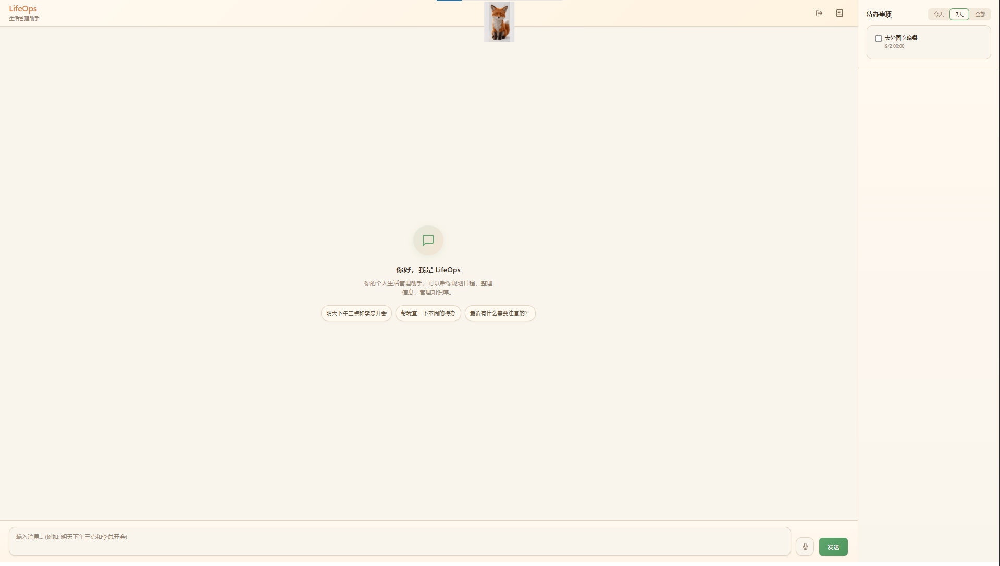

# LifeOps-Agent

基于 **FastAPI + LangGraph + SQLite + Qwen** 的个人生活管理智能体。通过自然语言对话管理待办、日程、记账、知识库，具备多步任务分解、人在回路确认、时间感知对话、本地语音输入和长期记忆能力。支持手机通过 Tailscale HTTPS 远程访问。

## 界面预览



·  
## 核心特性

- **多轮对话** — LangGraph 状态机编排，支持工具路由、多步计划分解、HITL 人机确认
- **工具调用（JSON 路由）** — 不依赖原生 Function Calling，LLM 输出 `{action, args}` JSON，代码按 action 分派执行，可无缝切换任意兼容 OpenAI 的模型
- **多步任务分解** — 复杂请求自动拆分为子步骤（如"查天气 + 查日程 + 综合回答"），按序执行后汇总；简单请求走快速通道跳过 LLM
- **人在回路（HITL）** — 待办草案先弹确认卡片，用户确认后经 `interrupt()` 恢复并直接写入数据库
- **待办管理** — 创建、查询、完成状态切换、截止日期跟踪；说"要"/"好的"/"确认"即可确认草案入库
- **时间感知对话** — 每条历史消息自动标注时间戳，模型能区分"刚刚聊的"和"很久以前聊的"，不会把旧日程当作当前状态
- **长期记忆** — 自动抽取生活事件、用户画像与隐性偏好，对话中主动引用背景，持续"逐渐懂你"且不删除任何历史
- **主动建议** — 基于日历、待办、记忆，在对话中主动提示时间冲突、健康风险等
- **日历与节日** — 查看日程事件，识别中国传统节日（端午、中秋、春节等）
- **天气查询** — 高德天气 API，实况 + 未来预报
- **记账** — 账户管理、收支记录、消费分析
- **知识库 RAG** — PDF/TXT/PNG 文档索引，BM25 / 向量 / 混合检索，可选重排序；语义切块 + 章节标题提取 + 块摘要
- **本地语音输入** — 手机录音上传，服务器本地 faster-whisper 识别中文，不依赖任何云端语音服务
- **手机远程访问** — 通过 Tailscale HTTPS 随时从手机访问（详见下文）

## 工作原理

### 架构

```text
用户输入 → ChatService → LangGraph 状态机 → 工具调用 → 应答返回
                              │
                 ┌────────────┼─────────────┐
                 │            │             │
            路由决策      多步分解      HITL/确认
                 │            │             │
           query_todos  query_calendar  query_weather
           query_knowledge  query_expenses  propose_todo
           record_expense  create_account  normal_chat
                              │
                         主动建议决策
```

### 工具调用机制

本项目**不使用原生 OpenAI Function Calling**（`chat_completion` 不传 `tools` 参数），而是采用**提示词驱动的 JSON 路由**：

1. `_node_decompose` 让 LLM 输出严格 JSON 决策：
   ```json
   {"action":"query_weather","args":{"city":"北京"},"mode":"normal","needs_plan":false}
   ```
   复杂请求可带 `steps` 多步计划；另有非 LLM 快路径（如"上一条""确认/取消"等固定短语短路）。
2. `_node_run_tool` 按 `action` 用 `if/else` 分派到具体工具（todo / weather / calendar / bookkeeping / RAG / DB 查询等）。
3. `needs_plan=true` 时进入 `run_tool → verify → advance_plan → decompose` 计划循环，逐步骤执行。
4. LLM 输出经 `normalize_llm_output` 清洗 + `verify` 重试兜底。

### 数据流

1. `ChatService.chat()` 接收消息 → 保存到 `chat_messages`
2. 抽取画像事实与个人事件 → 更新 `user_profiles` / `life_events`
3. 进入 LangGraph 状态机：`load_context → decompose → run_tool → (interrupter | verify) → advance_plan → (loop | finalize) → quality_gate → proactive_decision`
4. 保存助手消息 → 更新摘要 → 记忆抽取 → 可选深度反思

### 待办确认流程（HITL）

```text
用户: "明天下午3点去开会"
  → decompose: decision.action = propose_todo
  → run_tool: 构造待办草案 proposal.items（title / due_at）→ 设置 interrupt_message
  → interrupter: interrupt() 挂起状态机 → 前端弹出确认卡片
用户: 点击卡片"确认加入待办"（或直接回复"要"/"确认"）
  → 前端将"确认"作为新消息发送 → arun_chat_graph 检测到肯定语 → Command(resume="确认")
  → _handle_interrupt_resume: 读取 state.proposal.items → 直接写入 todo_items 表
  → 回复: "✅ 待办已确认！"
```

## 手机远程访问（Tailscale）

电脑放在实验室、手机随身携带时，通过 Tailscale 建立私有网络并以 HTTPS 访问（HTTP 下浏览器麦克风不可用）。

**电脑端**

```powershell
# 1. 安装并登录 Tailscale
tailscale up

# 2. 管理台开启 HTTPS 证书（https://login.tailscale.com/admin/dns → Enable HTTPS）

# 3. 把本地 5000 端口以 HTTPS 暴露（后台运行，配置持久，重启自动恢复）
"C:\Program Files\Tailscale\tailscale.exe" serve --bg 5000
# 输出形如 https://<机器名>.tail<编号>.ts.net
```

**手机端**

1. 安装 Tailscale App 并登录同一账号，确保 VPN 处于"已连接"状态
2. 浏览器打开 `https://<机器名>.tail<编号>.ts.net`
3. 点麦克风按钮即可中文语音输入

> 注意：服务本身需保持运行（`python -m app.src`）；Tailscale 与 serve 配置为系统服务/持久配置，电脑重启后自动恢复。

## 语音输入

- **前端**：`MediaRecorder` 录音（webm/opus），点击开始、再点停止，最长 20 秒自动结束
- **后端**：`POST /api/speech` 接收录音字节 → **faster-whisper 本地识别**（`WHISPER_MODEL`，默认 `small`）→ 返回文本自动回填输入框并发送
- **离线可用**：识别完全在实验室电脑本地完成，不依赖 Google/云端语音服务
- **模型本地化**：可将模型复制到项目目录并在 `.env` 设置 `WHISPER_MODEL_LOCAL` 指向本地路径，跳过 HuggingFace 下载
- **前提**：页面需通过 HTTPS 或 localhost 访问（`getUserMedia` 安全上下文限制）

## 时间感知对话

为了让助手区分"刚刚聊的"和"很久以前聊的"（同时保留全部历史用于持续学习）：

- 系统提示注入**当前时间**，并明确规则：近 30 分钟内的消息属于"刚刚发生的对话"（当前上下文），更早的属于"以前的对话"（背景记忆）
- 每条历史消息自动标注 `[MM-DD HH:MM]` 时间戳（从数据库 `created_at` 读取，对历史数据同样有效）
- 当前这条用户消息标注 `[刚刚]`
- 用户画像 / 生活事件 / 摘要 / 目标等背景统一标注为"**用户长期记忆（背景，不代表当前状态）**"
- 不删除任何对话或记忆，记忆抽取与积累照常运行

## 项目结构

```text
app/src/
├── agent/                    # 智能体层（核心大脑）
│   ├── agent_router.py       # LLM 路由决策（含知识主题感知 + 文档大纲注入）
│   ├── graph_chat.py         # LangGraph 状态机构建与执行、工具分派、时间感知对话
│   ├── post_chat_learn.py    # 对话后学习（记忆抽取、深度反思）
│   ├── memory/
│   │   ├── memory_extractor.py   # 对话记忆提取（confidence/insight_type）
│   │   └── personal_memory.py    # 生活事件/画像抽取、主动建议
│   ├── planner/planner.py    # 待办草案规划 + 确认/拒绝检测
│   └── time/time_parser.py   # 自然语言时间解析
├── common/
│   ├── config/               # 配置、数据库、LLM、日志、图持有器
│   │   ├── base_config.py    # pydantic-settings 配置模型
│   │   ├── llm_config.py     # LLM 调用封装（DashScope 兼容，JSON 路由）
│   │   ├── db_config.py      # 业务数据库（lifeops.db）含列迁移
│   │   ├── knowledge_db_config.py  # 知识库数据库含列迁移
│   │   ├── chat_graph_holder.py    # 全局图实例持有器
│   │   └── checkpointer_config.py  # LangGraph SQLite 检查点
│   ├── env/.env.example      # 环境变量模板
│   ├── static/               # 前端资源（app.js / style.css / 图片）
│   └── templates/            # HTML 模板
├── controller/               # API 路由层
│   ├── chat_controller.py    # 聊天（标准 + SSE 流式）
│   ├── speech_controller.py  # 语音识别接口
│   ├── todo_controller.py    # 待办
│   ├── plan_controller.py    # 待办草案
│   ├── bookkeeping_controller.py  # 记账
│   ├── auth_controller.py    # 登录（生成 session_id）
│   ├── rag_controller.py     # 知识库索引 / 问答
│   ├── health_controller.py  # 健康检查
│   └── web_controller.py     # 页面路由
├── domain/
│   ├── dto/                  # 数据传输对象
│   └── entity/               # SQLAlchemy ORM 模型 / ChatState TypedDict
├── service/                  # 业务服务层
│   ├── chat_service.py       # 聊天主服务
│   ├── asr_service.py        # 本地语音识别（faster-whisper 单例）
│   ├── plan_service.py       # 待办规划服务
│   ├── calendar_service.py   # 日历服务
│   ├── weather_service.py    # 天气服务
│   ├── bookkeeping_service.py # 记账服务
│   ├── memory_service.py     # 记忆读取
│   ├── goal_service.py       # 目标管理
│   ├── scheduler.py          # 定时任务（APScheduler）
│   ├── push_service.py       # 推送通知（Server酱 / Pushover）
│   └── chinese_holidays.py   # 中国传统节日动态计算
└── util/
    ├── ingest/               # 文档加载与 OCR
    └── retrieval/            # RAG 检索（BM25 + 向量 + 混合）
```

## 快速开始

### 环境要求

- Python 3.11+
- 可选：Tesseract OCR（PNG 文字识别，见下文）
- 可选：HuggingFace 网络（首次使用 RAG 时下载 embedding 模型，或配置本地模型路径）

### 安装

```powershell
# 1. 克隆仓库
git clone https://github.com/your-username/LifeOps-Agent.git
cd LifeOps-Agent

# 2. 创建虚拟环境（推荐 agent_env，已在 .gitignore 中）
python -m venv agent_env

# 3. 激活虚拟环境
.\agent_env\Scripts\Activate.ps1

# 4. 安装依赖
pip install -r requirements.txt
```

### 配置

```powershell
# 复制环境变量模板
copy app\src\common\env\.env.example app\src\common\env\.env
```

编辑 `app\src\common\env\.env`，至少填写以下项：

| 变量 | 必填 | 说明 |
|------|------|------|
| `QWEN_API_KEY` | **是** | 阿里云 DashScope API Key，从 [dashscope.console.aliyun.com](https://dashscope.console.aliyun.com/) 获取 |
| `QWEN_MODEL` | 否 | 模型名（默认 `qwen-turbo`） |
| `AMAP_WEATHER_KEY` | 否 | 高德天气 Web 服务 Key，从 [console.amap.com](https://console.amap.com/dev/key/app) 申请 |
| `DOCS_DIR` | 否 | 知识库文档目录路径 |
| `WHISPER_MODEL` | 否 | 语音识别模型（默认 `small`） |
| `WHISPER_MODEL_LOCAL` | 否 | 本地语音模型目录（配置后跳过下载） |

详细配置说明见 `.env.example` 内的注释。

### 启动

```powershell
# 确保虚拟环境已激活
python -m app.src
```

访问 **http://localhost:5000**（首次使用会同时初始化业务库、知识库和 LangGraph 检查点）。

### 首次使用

1. 打开首页，输入用户名登录（登录名即会话 ID）
2. 在聊天框输入你的计划或问题
3. 如需知识库问答：在 `.env` 设置 `DOCS_DIR` → 页面"知识库"面板点索引 → 开始提问
4. 待办草案生成后点"确认加入待办"（或回复"要"/"确认"）即入库
5. 语音：点击输入框旁麦克风 → 说话 → 再点一下停止 → 自动识别并发送

## API 速览

| 方法 | 路径 | 说明 |
|------|------|------|
| GET | `/` | Web 聊天页面 |
| POST | `/api/auth/login` | 登录（返回 session_id） |
| GET | `/health` | 健康检查 |
| POST | `/api/chat` | 标准聊天 |
| POST | `/api/chat/stream` | SSE 流式聊天（实时进度显示） |
| POST | `/api/speech` | 语音识别（上传录音字节，返回文本） |
| POST | `/api/plan/propose` | 生成待办草案 |
| GET | `/api/todos/today` | 今日待办 |
| GET | `/api/todos/upcoming?days=7` | 未来待办 |
| GET | `/api/todos/all` | 全部待办 |
| POST | `/api/todos/{id}/status` | 更新完成状态 |
| POST | `/api/index` | 知识库索引（含块摘要生成） |
| POST | `/api/ask` | 知识库问答 |
| POST | `/api/accounts` | 创建账户 |
| GET | `/api/accounts` | 账户列表 |
| GET | `/api/accounts/balances` | 账户余额 |
| DELETE | `/api/accounts/{id}` | 删除账户 |
| POST | `/api/transactions` | 记录收支 |
| GET | `/api/transactions` | 交易记录 |
| GET | `/api/transactions/analysis` | 消费分析 |

## 测试

```powershell
# 运行全部测试（无需 API Key 或网络，LLM 调用已自动 mock）
python -m pytest tests/ -v
```

测试覆盖 planner、agent_router、graph_chat、memory、time_parser 的核心逻辑及所有 DTO 校验。LLM 调用在 `conftest.py` 中自动 mock。

## 性能评估

针对「对外可展示的硬性性能指标」提供一整套可复现的评估脚本：检索质量（B 类）与任务/路由（C 类）。评估集按自建知识库（`E:\work\knowledge_for_test` 下的 txt）设计，ground truth 由知识库作者标注，自洽可复现。评估会调用**真实 LLM**（与生产完全一致，有 API 成本），因此请使用完整环境运行：

```powershell
# 运行环境：lifeops conda 环境（已安装 sentence_transformers / faiss-cpu / langchain-community 等）
E:\Anaconda\envs\lifeops\python.exe -m app.eval.run_retrieval   # 检索质量评估
E:\Anaconda\envs\lifeops\python.exe -m app.eval.run_task        # 任务/路由评估（真实 LLM 路由）
E:\Anaconda\envs\lifeops\python.exe -m app.eval.report          # 把 JSON 报告渲染成 markdown
```

评估代码位于 `app/eval/`：`cases.py`（评估集）、`metrics.py`（指标计算）、`run_retrieval.py` / `run_task.py`（运行器，支持增量落盘）、`report.py`（markdown 渲染）。报告输出到 `app/eval/reports/*.json/.md`。

### 指标口径（为什么看 "Recall@1/3/5"）

每次查询，系统返回按相关度排序的 N 条候选文档，我们检查「正确答案有没有出现在前 k 条里」：

| 指标 | 含义 |
| --- | --- |
| **Recall@1** | 返回的**第 1 条**（最自信）就是正确答案的比例 —— 最严、最能反映"第一刀准不准" |
| **Recall@3** | 前 **3 条**里有正确答案的比例 |
| **Recall@5** | 前 **5 条**里有正确答案的比例 |
| **MRR** | 首个正确答案的排名倒数均值（全未命中记 0）—— 衡量"正确答案排得有多靠前" |
| **NDCG@k** | 排序质量指标，奖励相关文档排在前面 |

一句话：**@ 后的数字越大要求越宽松**（@1 只看第一条，@5 前五条沾边就算），因此数值通常 @1 ≤ @3 ≤ @5 逐级升高，说明"正确答案基本都在返回列表里，只是偶尔不在第一刀"。

### 当前结果（生产路径 hybrid + 重排）

**检索质量（46 条 case）**

| 指标 | 分值 |
| --- | --- |
| Recall@1 | 0.891 |
| Recall@3 | 0.978 |
| Recall@5 | 1.000 |
| MRR | 0.932 |
| NDCG@5 | 0.935 |

**任务/路由（10 条 case，真实 LLM 路由 `_node_decompose`）**

- 动作精确匹配准确率：**0.700**
- 精确命中或落入多步计划：**0.900**

> 说明：路由的 3 条非精确命中，均为路由器「先查库自己解决」的设计原则——对模糊指令优先走 `query_database` 兜底（其中 2 条期望动作仍在多步计划内），并非检索失败。

### 已知修复：混合检索融合 bug

检索评估过程中诊断并修复了一个生产缺陷（`app/src/util/retrieval/retrieval.py` 的 `_rrf_fuse`）。

**原实现**用「排名倒数求和（RRF）」融合 4 个检索通道，但词法通道（`bm25` / `rewrite-bm25` / 路径）本质是同一强相关信号的多份拷贝，高度重叠时会**重复计票**：例如查询「GTD 方法的核心流程」时，错答案 `career_plan.txt` 在词法通道排 1/2/3（多份叠加），反而压过「向量通道排第 1」（得分 84.66）的真正答案 `productivity_todo.txt`，导致把 GTD 错误路由到 career_plan。

**处理方式**：不再用排名倒数相加，改为**直接按规范相关度得分（0-100）排序**，且每个文档只出一个代表块。分数上界本身已内建信任层级（向量 85 > BM25 60 > 路径 28），因此拿高分的真·语义命中天然排在前面。修复后 GTD、LeetCode 等此前错配的查询全部正确命中；`pytest`（175 项）零回归。

## 可选依赖说明

### Tesseract OCR

如需知识库支持 PNG 图片文字识别：

```powershell
# Windows: 下载安装 https://github.com/UB-Mannheim/tesseract/wiki
# 在 .env 中设置 TESSERACT_CMD 指向 tesseract.exe
TESSERACT_CMD=C:\Program Files\Tesseract-OCR\tesseract.exe

# Linux: sudo apt install tesseract-ocr tesseract-ocr-chi-sim
```

### Embedding 模型（RAG 向量检索）

首次使用 `RAG_BACKEND=hybrid` 或 `langchain` 时，自动从 HuggingFace Hub 下载 `BAAI/bge-small-zh-v1.5`。如需加速（中国大陆），在 `.env` 中设置：

```ini
HF_ENDPOINT=https://hf-mirror.com
```

也可像 `RAG_EMBED_MODEL_LOCAL` / `RAG_RERANK_MODEL_LOCAL` 一样配置本地模型路径。

### 语音识别模型（faster-whisper）

首次识别时自动从 HuggingFace 下载 `Systran/faster-whisper-small`（约 460MB）。建议复制到项目目录后配置：

```ini
WHISPER_MODEL_LOCAL=E:\work\LifeOps-Agent\faster-whisper-small
```

### 推送通知

支持 Server酱（微信推送）和 Pushover，参考 `.env` 中的注释配置。

## 常见问题

**Q: 启动报错 `pydantic-settings` 相关？**
确保已复制 `.env.example` 为 `.env` 并填写 `QWEN_API_KEY`。

**Q: 数据库文件在哪？**
SQLite 文件自动创建在 `app/data/` 目录下（`lifeops.db`、`knowledge_base.db`、`checkpointer.db`），该目录已加入 `.gitignore`。

**Q: 模型下载太慢或失败？**
在 `.env` 中设置 `HF_ENDPOINT=https://hf-mirror.com` 使用国内镜像；语音模型可用 `WHISPER_MODEL_LOCAL` 走本地路径。

**Q: 如何更换 LLM 模型？**
在 `.env` 中修改 `QWEN_MODEL`。通过 DashScope 兼容接口也可使用第三方模型。

**Q: 手机语音按钮没反应？**
必须是 HTTPS 或 localhost 访问（`getUserMedia` 安全上下文限制）。经 Tailscale `serve` 暴露的 `https://...ts.net` 地址可用；直接用 `http://<tailscale-ip>:5000` 则语音不可用。

**Q: 助手把很久以前的对话当成刚聊的？**
时间感知功能会自动给历史消息标注时间戳并注入当前时间；这是最近一次对话起生效，重启服务后加载新逻辑即可。

## 开发说明

- **新增配置**：在 `common/config/base_config.py` 加字段，`llm_config.py` 统一调用
- **新增工具**：在 `graph_chat.py` 的 `_node_run_tool` 加 `if action == "xxx"` 分支，并在 decompose 系统提示的工具说明中补充描述
- **新增状态字段**：`domain/entity/chatstate_entity.py` 加 TypedDict 字段，`graph_chat.py` 的 `_build_initial_state` / `_build_checkpoint_context` 同步更新
- **数据库迁移**：新列通过 `ALTER TABLE ADD COLUMN` 在 `init_db()` 中自动补齐（无需 Alembic）
- **调试日志**：设置 `LOG_LEVEL=DEBUG` 查看 LLM 调用、路由细节和 RAG 检索过程

## .gitignore 覆盖内容

- `.env` 及所有敏感配置
- `app/data/`（SQLite 数据库、向量索引）
- 模型权重（`bge-*/`、`*.safetensors`、`faster-whisper-*/`）
- `__pycache__`、`.idea`、`.vscode`
- 虚拟环境 `agent_env/`、`.venv/`