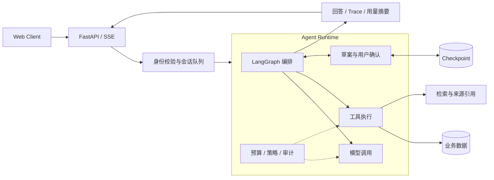

<div align="center">

# LifeOps-Agent

### 面向个人事务管理的 AI Agent

自然语言交互 · 多步任务编排 · 人机确认 · 可追溯执行

**FastAPI · LangGraph · SQLite · Qwen · Docker**

[快速开始](#快速开始) · [系统架构](#系统架构) · [测试与评估](#测试与评估) · [部署指南](docs/deployment.md) · [设计文档](docs/harness-design.md)

</div>

---

LifeOps-Agent 将待办、记账、日历和知识库整合到统一的对话入口。模型负责理解请求与生成计划，应用负责执行约束、用户确认和数据持久化，通过 SSE 展示处理进度、回答、来源引用与执行轨迹。

项目同时提供真实模型模式与无需 API Key 的离线演示，涵盖 Agent 编排、运行时控制、回归评估和容器化部署。


## 核心能力

| 能力 | 实现方式 |
| --- | --- |
| **任务编排** | LangGraph 管理多轮状态、JSON 动作路由、多步计划、执行验证与结果汇总 |
| **人机确认** | 待办先生成草案，通过 checkpoint 支持确认、修改和取消；已有账户余额变更须确认 |
| **知识库问答** | BM25 / 向量 / 混合检索，支持 RRF 融合、可选重排和来源引用 |
| **个人记忆** | 保留聊天原文，增量生成摘要，按身份隔离画像、事件与学习文件 |
| **运行控制** | 独立 Harness 管理时间、调用次数和 token 预算，拦截工具请求并记录审计 |
| **交互与工具** | SSE 流式交互、请求取消、待办、收支、日历、天气与可选本地语音 |

## 系统架构



### 编排与确认

路由层将请求转换为 `{action, args}`，复杂任务生成多步计划，由程序分派工具并汇总执行结果。同一会话通过进程内 FIFO 队列串行处理，降低并发请求覆盖 checkpoint 的风险。

待办使用 LangGraph `interrupt()` 暂停执行，保存草案后等待用户操作：

```text
描述任务 → 生成草案 → 用户修改 / 确认 / 取消 → 恢复执行 → 返回结果
```

确认后写入待办，取消则结束该流程。已有账户余额变更也需要确认；收支记录等操作遵循各自业务规则。

### 运行时 Harness

Harness 独立于模型可修改的图状态，对模型与工具调用施加统一约束：

- **预算控制**：限制墙钟时间、LLM / 工具调用次数、token 和图超级步数。
- **工具策略**：动作白名单、只读 SQL 校验、会话作用域视图与 SQLite authorizer。
- **可观测性**：记录耗时、用量来源、异常和预算状态，输出 `harness_summary` 与元数据审计。
- **前后台隔离**：学习、记忆和文档摘要使用独立预算；等待用户确认不占用执行时间。

供应商返回 usage 时记录实际用量，缺失时标记并采用保守预留量控制预算。详细机制见 [Harness 设计](docs/harness-design.md)。

### 检索与记忆

默认 BM25 无需向量模型；可选混合链路采用 **BM25 + 向量召回 → RRF 融合 → 交叉编码器重排**，保留文档路径、页码和章节信息，供回答引用。

原始对话持续留存，摘要按游标增量更新。个人画像、事件和学习文件按身份隔离，并为历史内容附加时间信息，帮助模型区分背景记录与当前安排。

## 快速开始

### Docker 演示

在已启动 Docker 的环境中，于仓库根目录执行：

```bash
docker compose up -d --build
```

访问 **http://127.0.0.1:5001**，使用 `demo` / `lifeops-demo-2026` 登录。

> 演示使用规则模拟模型、BM25 和仓库内虚构资料，无需 API Key 或模型下载；HTTP/SSE、图执行、身份校验和数据库操作均实际运行。语音与后台学习默认关闭，天气使用虚构数据。

| 体验步骤 | 输入示例 | 观察结果 |
| --- | --- | --- |
| 创建草案 | `明天下午3点开会` | 展示草案，尚未写入待办 |
| 修改安排 | `可以改成后天吗` | 更新草案日期 |
| 确认或取消 | `确认` / `取消` | 写入待办或结束流程 |
| 查询结果 | `查询待办` | 查看当前待办 |
| 知识库问答 | `报销需要哪些材料` | 回答附带虚构制度来源 |

```bash
# 验证部署后的 HTTP/SSE、确认流程、引用与执行摘要
docker compose exec -T lifeops-demo python scripts/smoke.py --url http://127.0.0.1:5000

# 停止服务，保留数据卷
docker compose down
```

演示数据使用专用 volume。镜像构建源、Docker Desktop context 和端口配置见[部署指南](docs/deployment.md)。

### 真实模型模式

建议使用 Python **3.11**。Windows PowerShell 示例：

```powershell
python -m venv .venv
.\.venv\Scripts\Activate.ps1
python -m pip install -r requirements-core.txt
Copy-Item app/src/common/env/.env.example app/src/common/env/.env
```

编辑 `.env`，设置 `QWEN_API_KEY`、实际 `DOCS_DIR`，并保持 `DEMO_MODE=false`、`DEMO_SEED=false`。按需修改 `QWEN_MODEL` 与 `BASE_URL`，随后启动：

```powershell
python -m app.src
```

访问 http://localhost:5000。首次注册须从服务本机回环地址访问，并设置至少 8 位密码；后续使用同一账号登录。身份由 HttpOnly Cookie 校验。

可选向量检索与语音依赖位于 `requirements-ml.txt`，需要另外准备模型；PNG OCR 还需 Tesseract。完整配置见[环境变量模板](app/src/common/env/.env.example)。

## 测试与评估

以下为 **2026-10-27** 的验证快照：

| 验证层级 | 结果 | 覆盖范围 |
| --- | --- | --- |
| 单元与回归测试 | **285 项通过** | 编排、业务、认证、隔离、预算与日期处理 |
| 端到端流程契约 | **100 / 100 通过** | HTTP/SSE、图、checkpoint 与隔离 SQLite |
| Docker Compose | **冒烟通过** | 就绪、登录、确认/取消、来源引用与执行摘要 |
| kind | **部署及冒烟通过** | 独立命名空间、单副本、PVC 与实际 HTTP 流程 |

[查看流程报告](app/eval/reports/e2e-contract.md) · [查看逐例结果与源码指纹](app/eval/reports/e2e-contract.json)

流程契约使用模拟模型，包含 10 类场景各 10 个变体，覆盖确认、取消、修改、多日期、记账、账户变更、引用、权限拦截、预算耗尽和供应商故障。**通过率反映程序契约，不代表真实模型准确率；报告延迟也不代表线上网络或模型性能。**

```bash
# 在隔离 Linux 镜像中复跑
docker build --target test -t lifeops-agent:test .
docker run --rm lifeops-agent:test
docker run --rm lifeops-agent:test python -m app.eval.run_e2e
```

真实模型回归须配置 Key 并显式启用付费调用：

```bash
python -m app.eval.run_e2e --mode real --allow-paid-calls --output artifacts/e2e-real.json
```

真实模式运行 80 条流程用例，排除模拟故障与模拟跨用户 SQL 的专用场景。真实模型保留集与组件消融评估仍待补充。原有[检索报告](app/eval/reports/retrieval.md)和[路由报告](app/eval/reports/task.json)依赖外部语料，作为历史记录保留。

## 部署与持续集成

| 组件 | 配置入口 | 说明 |
| --- | --- | --- |
| Docker | [Dockerfile](Dockerfile) | 多阶段构建，区分运行、测试与可选 ML 目标，非 root 用户运行 |
| Compose | [compose.yaml](compose.yaml) | 独立数据卷、只读根文件系统、本地回环端口与健康检查 |
| Kubernetes | [kind 配置](deploy/kind/demo.yaml) | 单副本 Deployment、Service、PVC 与探针 |
| Jenkins | [Jenkinsfile](Jenkinsfile) | 构建、检查、测试、报告归档、冒烟与可选 kind 部署 |
| GitHub Actions | [ci.yml](.github/workflows/ci.yml) | 容器验证与报告归档 |

Docker / kind 已完成本地验证。流水线配置已提供，Jenkins 执行节点仍需接入；可选 ML 镜像目标需单独验证。部署前提、持久化和操作命令见[部署指南](docs/deployment.md)。

## 项目结构

```text
app/
├── src/
│   ├── agent/              # 图编排、规划、时间解析与记忆提取
│   ├── common/harness/     # 预算、拦截器、SQL 作用域与审计
│   ├── common/config/      # 配置、模型客户端、数据库与 checkpoint
│   ├── common/static/      # Web 交互与静态资源
│   ├── common/templates/   # Web 页面模板
│   ├── controller/         # SSE、认证、业务与健康检查接口
│   ├── service/            # 业务服务、后台学习与定时任务
│   ├── domain/             # 数据模型、ORM 实体与图状态
│   ├── demo/               # 模拟模型与虚构数据初始化
│   └── util/               # 文档加载、OCR 与检索
└── eval/                   # 流程契约、模型评估与公开报告
examples/knowledge/         # 可复现的虚构语料
scripts/                    # 部署冒烟工具
tests/                      # 单元与回归测试
deploy/kind/                # Kubernetes 配置
```

## 设计边界与路线

当前采用单进程、单副本 SQLite 和进程内会话队列，适用于个人部署及本地演示。`Recreate` 更新期间会短暂停机；多副本运行需要外部数据库、共享 checkpoint、分布式协调和跨进程幂等机制。

后续重点：

- 建立真实模型保留集，覆盖歧义、否定、跨任务对话与工具失败，统计任务成功率、实际 token 和响应延迟。
- 固定语料与参数，对 BM25、向量、混合检索和重排进行消融比较。
- 拆分工具注册与参数 schema，完善数据库级幂等、迁移和备份能力。

本地密钥、数据库、个人记忆、模型权重和运行产物不纳入版本控制。项目演示路径与技术讲解见[展示指南](docs/showcase.md)。
