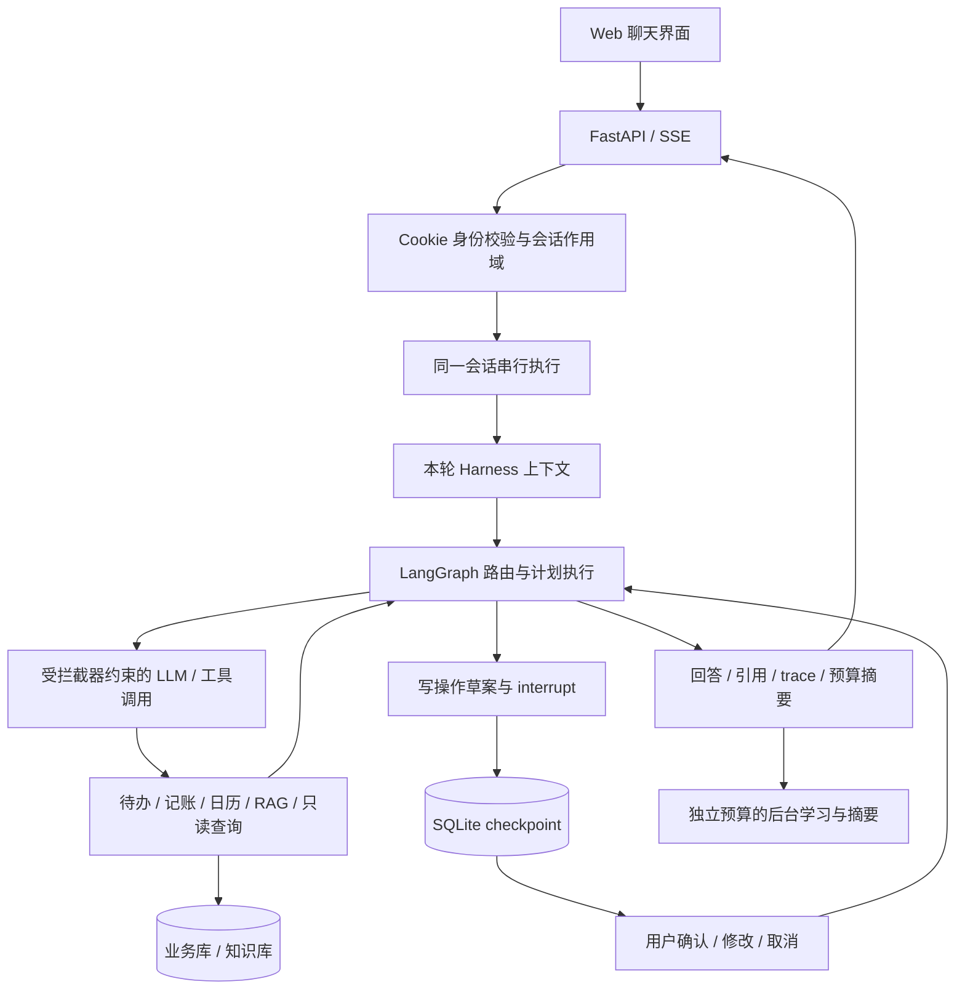

# LifeOps-Agent

**把自然语言请求变成可确认、可追溯的个人事务操作。**

基于 FastAPI、LangGraph、SQLite 和 Qwen 兼容接口的个人生活管理 Agent，支持待办、记账、日历和知识库问答。主交互采用 SSE，展示处理进度、增量文本、资料引用和执行轨迹；待办草案与现有账户余额变更经过用户确认后写入数据库。

项目覆盖从 Agent 编排到运行约束、回归评估、容器化交付的完整开发过程。提供无需 API Key 的演示模式，也支持接入真实模型和本地检索、语音模型。

[快速体验](#快速体验) · [架构与设计](#架构与设计) · [测试与评估](#测试与评估) · [部署文档](docs/deployment.md) · [Harness 设计](docs/harness-design.md)


## 快速体验

安装并启动 Docker，在仓库根目录执行：

```bash
docker compose up -d --build
```

打开 **http://127.0.0.1:5001**，使用以下演示账号登录：

| 用户名 | 密码 |
| --- | --- |
| `demo` | `lifeops-demo-2026` |

演示使用规则模拟模型和仓库内的虚构资料，实际运行 HTTP/SSE、LangGraph、HITL、身份校验和 SQLite。运行期间无需模型 API Key，不下载模型权重。模拟模型用于体验工程流程，其回答和测试通过率不代表真实模型质量。

可以按以下顺序体验：

1. 输入「明天下午3点开会」，查看待办草案，此时尚未写入待办。
2. 输入「可以改成后天吗」，查看修改后的日期，再输入「确认」。
3. 输入「查询待办」，核对已创建的记录；也可以另建草案后输入「取消」。
4. 输入「报销需要哪些材料」，查看回答与虚构制度的来源引用。
5. 展开执行轨迹，查看工具调用和 `harness_summary`。

```bash
# 检查服务状态与真实 HTTP/SSE 流程
docker compose ps
docker compose exec -T lifeops-demo python scripts/smoke.py --url http://127.0.0.1:5000

# 停止服务并保留演示数据
docker compose down
```

演示数据存放在专用 volume，与本地个人数据库隔离。若 PyPI 连接失败，可设置构建变量 `PIP_INDEX_URL=https://pypi.tuna.tsinghua.edu.cn/simple` 后重试。Windows Docker Desktop 的当前 context 不可用时，可使用 `docker --context desktop-linux compose ...`。更多配置见[部署说明](docs/deployment.md)。

## 能力与运行模式

| 能力 | 实现 | 默认离线演示 |
| --- | --- | --- |
| 多轮对话与任务编排 | JSON 路由、工具执行、多步计划、验证与汇总 | 使用规则模拟模型 |
| 待办与 HITL | 草案生成、修改、取消、确认及日期处理 | 可体验完整流程 |
| 账户与记账 | 收支记录、账户查询、已有账户余额变更确认 | 使用虚构账户与数据 |
| 知识库 RAG | BM25、向量、混合检索与可选重排，保留来源信息 | BM25 + 仓库内虚构文本 |
| 运行约束 | 调用次数、时间、token 预算，工具策略、会话作用域与审计 | 经过真实执行链路 |
| 长期记忆 | 对话原文留存、增量摘要、用户画像、事件与会话学习文件 | 后台学习关闭 |
| 日历与天气 | 日历查询、传统节日、高德天气服务 | 天气使用明确标注的虚构数据 |
| 本地语音 | faster-whisper 识别浏览器录音 | 默认关闭，需额外依赖与模型 |

## 架构与设计



### 任务编排与人在回路

模型输出 `{action, args}` JSON，程序负责解析、分派和执行；复杂任务可以返回多步计划。当前实现采用提示词驱动的 JSON 路由，不依赖供应商原生 Function Calling，仍需针对目标模型验证格式稳定性和动作选择。

待办先生成草案，由 LangGraph `interrupt()` 挂起并持久化 checkpoint。用户确认后恢复执行并写库，修改则更新草案，取消则结束该流程。已有账户余额变更也需要确认；收支记录等其他操作采用各自业务规则，并非所有写操作都经过同一确认流程。

同一会话使用进程内 FIFO 队列，避免并行消息覆盖 checkpoint。前端使用 `/api/chat/stream`，通过 `status`、增量文本和 `final` 等事件呈现执行过程，并支持取消当前请求。

### Harness：约束执行，而非只依赖提示词

预算与拦截器独立于模型可修改的图状态，覆盖前台聊天、独立问答/计划入口和后台任务：

- 限制 LLM 调用数、工具调用数、墙钟时间、token 预算及图超级步数。
- 在工具入口校验动作白名单、只读 SQL 和当前会话作用域；数据库查询还使用作用域视图与 SQLite authorizer 限制访问。
- 汇总调用耗时、用量、异常与预算状态，返回 `harness_summary` 并记录本地元数据审计。
- 后台学习、记忆与文档摘要使用独立预算，不占用主回复的执行额度。

供应商返回 usage 时记录实际用量；未返回时使用保守预留值控制预算，并标记用量缺失。预留量不等于真实 token 账单。HITL 等待用户的时间不占本轮执行预算，恢复请求建立新的执行上下文。详见 [Harness 设计](docs/harness-design.md)。

### RAG 与记忆

文档加载后存入独立知识库，保留路径、页码和章节信息。默认 BM25 可在无向量模型的环境运行；可选混合检索将 BM25 与向量召回通过 RRF 融合，再使用交叉编码器重排。回答携带来源引用，证据不足时返回相应提示。

聊天原文保留，摘要通过游标增量更新；用户画像、个人事件和学习文件按身份隔离。记忆用于提供背景，时间标注用于帮助模型区分历史记录与当前安排，但不能保证模型永远正确理解时间。

## 测试与评估

**2026-10-27 已执行的验证：**

| 验证项 | 结果 | 测量范围 |
| --- | --- | --- |
| Linux 容器单元与回归测试 | **285 项通过** | 编排、业务、认证、隔离、预算、日期与数据处理 |
| 合成端到端流程契约 | **100 / 100 通过** | 模拟模型 + 真实 HTTP/SSE、图、checkpoint 与隔离数据库 |
| Docker Compose 冒烟 | **通过** | 就绪、登录、SSE、取消/确认、RAG 引用与 Harness 摘要 |
| kind 部署冒烟 | **通过** | 独立命名空间、单副本、PVC 与实际 HTTP 流程 |

[流程报告](app/eval/reports/e2e-contract.md) · [逐例 JSON 与源码指纹](app/eval/reports/e2e-contract.json)

100 条契约由 10 类场景各 10 个变体组成，覆盖待办确认、取消、修改、多日期、历史消费记账、账户变更确认、资料引用、权限拦截、预算耗尽和模拟供应商失败。它检验程序行为，**不是 100 个独立真实用户任务，也不是模型准确率或网络负载测试**。

### 复跑容器测试

```bash
docker build --target test -t lifeops-agent:test .
docker run --rm lifeops-agent:test
docker run --rm lifeops-agent:test python -m app.eval.run_e2e
```

需要保存 JUnit、JSON 和 Markdown 报告时，使用[部署文档中的报告归档命令](docs/deployment.md#测试与报告)。默认测试不调用付费模型 API，使用临时数据库。

本地 Python 环境也可运行单元测试：

```bash
python -m pip install -r requirements-dev.txt
python -m pytest tests -q
```

### 真实模型与历史评估

配置真实 Key 后，可显式运行独立数据库中的真实模型流程回归；这会产生 API 费用：

```bash
python -m app.eval.run_e2e --mode real --allow-paid-calls --output artifacts/e2e-real.json
```

真实模式保留 80 条流程用例，排除模拟故障与模拟跨用户 SQL 的 20 条专用用例。本轮未执行真实模型评估。

仓库另保留 [2026-09-05 检索报告](app/eval/reports/retrieval.md)及[历史路由报告](app/eval/reports/task.json)。这些结果依赖原有外部知识库，未随本次容器化重新测量，不能用演示语料复现，也不能用作当前版本的端到端准确率或组件增益结论。

## 接入真实模型

建议使用 Python **3.11** 与独立虚拟环境。以下为 Windows PowerShell 示例：

```powershell
python -m venv .venv
.\.venv\Scripts\Activate.ps1
python -m pip install -r requirements-core.txt
Copy-Item app/src/common/env/.env.example app/src/common/env/.env
```

编辑 `app/src/common/env/.env`：

| 配置 | 用途 |
| --- | --- |
| `DEMO_MODE=false`、`DEMO_SEED=false` | 运行真实模式，不注入演示数据 |
| `QWEN_API_KEY` | 模型 API Key，真实模式必填 |
| `QWEN_MODEL`、`BASE_URL` | 模型名与兼容服务地址 |
| `DOCS_DIR` | 实际知识库目录 |
| `RAG_BACKEND=bm25` | 无向量模型的初始配置 |
| `AMAP_WEATHER_KEY` | 可选，高德天气服务 |
| `PERSONAL_MEMORY_DIR`、数据库路径 | 可选，自定义个人数据存储位置 |

```powershell
python -m app.src
```

打开 http://localhost:5000。首次注册须从服务本机回环地址访问，设置至少 8 位密码；之后使用同一账号登录。服务使用 HttpOnly Cookie 校验身份，并检查请求的会话作用域。

向量检索和语音需要另装 `requirements-ml.txt` 及相应模型；完整依赖入口为 `requirements.txt`。PNG OCR 还需 Tesseract 系统程序。浏览器录音需要 localhost 或 HTTPS。完整配置见[环境变量模板](app/src/common/env/.env.example)，容器运行真实模式时须使用新的专用 volume，避免复用公开演示账号和数据。

## 工程交付

- **Docker**：多阶段构建，区分运行、测试与可选 ML 目标；非 root 用户运行，配置就绪探测，个人数据与镜像分离。
- **Compose**：本地回环端口、专用数据卷、只读根文件系统与临时目录。
- **kind**：复用已有集群，在 `lifeops-demo` 命名空间运行单副本 Deployment、Service 和 PVC。
- **Jenkins**：[Jenkinsfile](Jenkinsfile) 包含构建、静态检查、测试、报告归档、冒烟与可选 kind 部署，需要带 Docker CLI 的 Linux 执行节点。
- **GitHub Actions**：[CI 配置](.github/workflows/ci.yml) 提供容器测试和报告归档。

Docker / kind 已在本地验证。Jenkins 与 GitHub Actions 配置已提供，尚无本轮远端流水线成功记录；本地 Jenkins 执行节点仍待配置。ML 镜像目标未在本轮构建验证。操作步骤和环境前提见[部署说明](docs/deployment.md)。

## 代码导航

```text
app/
├── src/
│   ├── agent/                 # LangGraph 编排、规划、时间解析与记忆提取
│   ├── common/harness/        # 预算上下文、拦截器、SQL 作用域与审计
│   ├── common/config/         # 配置、模型客户端、数据库与 checkpoint
│   ├── common/static/         # Web 前端资源
│   ├── common/templates/      # Web 页面模板
│   ├── controller/            # SSE、认证、业务与健康检查接口
│   ├── service/               # 聊天、待办、记账、学习及后台任务
│   ├── domain/                # 请求/响应模型、ORM 实体与图状态
│   ├── demo/                  # 明确标注的规则模拟模型与虚构数据初始化
│   └── util/                  # 文档加载、OCR 与检索
└── eval/                      # 流程契约、历史检索/路由评估与公开报告
examples/knowledge/            # 可公开、可复现的虚构语料
scripts/smoke.py               # 已部署服务的 HTTP/SSE 冒烟
tests/                         # 单元与回归测试
deploy/kind/                   # 本地 Kubernetes 部署
```

## 当前边界与后续工作

当前采用单进程、单副本 SQLite 和进程内会话队列；`Recreate` 部署更新期间会短暂停机。不能仅通过增加副本实现安全扩容，跨进程幂等、分布式协调、外部 checkpoint 与数据库迁移仍需进一步建设。

模型输出仍可能路由错误或生成不完整参数。下一步优先补充真实模型保留集、歧义/否定与工具失败用例，测量真实 token 和响应延迟；RAG 的组件增益需要固定语料与参数的消融实验。工具注册和参数 schema 也需继续从图分派逻辑中解耦。

本地 `.env`、数据库、个人记忆、模型权重和运行报告由 `.gitignore` 排除；公开样例、部署配置及经过核对的评估报告保留在仓库中。项目演示与技术讲解可参考[展示指南](docs/showcase.md)。
