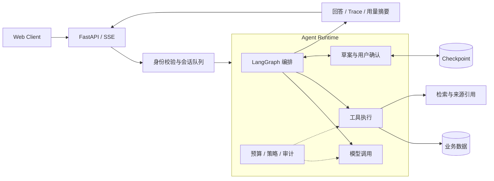

<div align="center">

# LifeOps-Agent

### 面向个人事务管理的 AI Agent

自然语言交互 · 多步任务编排 · 人机确认 · 可追溯执行

**FastAPI · LangGraph · SQLite · Qwen · Docker**

[快速开始](#快速开始) · [系统架构](#系统架构) · [测试与评估](#测试与评估) · [部署与持续集成](#部署与持续集成) · [Harness 源码](app/src/common/harness/)

</div>

---

LifeOps-Agent 将待办、记账、日历和知识库整合到统一的对话入口。模型负责理解请求与生成计划，应用负责执行约束、用户确认和数据持久化，通过 SSE 展示处理进度、回答、来源引用与执行轨迹。

项目同时提供真实模型模式与无需 API Key 的离线演示，涵盖 Agent 编排、运行时控制、回归评估和容器化部署。评审可按[5–8分钟演示路线](DEMO.md)核对用户流程、关键源码与对应验收证据。


## 核心能力

| 能力 | 实现方式 |
| --- | --- |
| **任务编排** | LangGraph 管理多轮状态、JSON 动作路由、多步计划、执行验证与结果汇总 |
| **人机确认** | 待办先生成草案，通过 checkpoint 支持确认、修改和取消；已有账户余额变更须确认 |
| **知识库问答** | BM25 / 向量 / 混合检索，支持 RRF 融合、可选重排和来源引用 |
| **个人记忆** | 保留聊天原文，增量生成摘要，按身份隔离画像、事件与学习文件 |
| **可靠执行** | 请求回执与业务操作双层幂等，支持中断补充、部分写入提示、跨进程结果恢复与队列过载拒绝 |
| **运行控制** | 独立 Harness 管理时间、调用次数和 token 预算，拦截工具请求并记录审计 |
| **工具契约** | 统一注册参数 schema、副作用与确认要求，模型工具目录与执行校验同源，参数拒绝后停止后续计划 |
| **交互与工具** | SSE 流式交互、请求取消、待办、收支、日历、天气与可选本地语音 |

## 系统架构



### 编排与确认

路由层将请求转换为 `{action, args}`，复杂任务生成多步计划，由程序分派工具并汇总执行结果。同一会话通过进程内 FIFO 队列串行处理，降低并发请求覆盖 checkpoint 的风险。

队列默认最多接收全进程 32 个任务、单会话 8 个任务（均包含运行中与排队中）。超限通过 SSE `error` 返回可重试提示，不启动该任务；空闲会话自动释放队列与 worker。关闭服务时停止接收新任务，默认排空 15 秒，随后取消剩余任务并等待工具退出，再关闭 checkpoint；这些容量限制仅对单进程有效。

主动停止会把原问题、计划进度、未完成输出和已提交操作回执存入业务库。下一条补充条件会携带这份中断上下文供模型重新规划；原请求重试返回已中止结果。停止不会撤销已提交写入，也不保证恢复模型内部推理。

待办使用 LangGraph `interrupt()` 暂停执行，保存草案后等待用户操作：

```text
描述任务 → 生成草案 → 用户修改 / 确认 / 取消 → 恢复执行 → 返回结果
```

确认后写入待办，取消则结束该流程。已有账户余额变更也需要确认；收支记录等操作遵循各自业务规则。

### 运行时 Harness

Harness 独立于模型可修改的图状态，对模型与工具调用施加统一约束：

- **预算控制**：限制墙钟时间、LLM / 工具调用次数、token 和图超级步数。
- **工具策略**：动作白名单、只读 SQL 校验、会话作用域视图与 SQLite authorizer。
- **参数边界**：[统一工具契约](app/src/domain/tool_registry.py)生成模型可见目录，校验金额、日期、枚举、查询上限及未知字段；身份由服务端注入，内部确认动作不对模型开放。
- **执行失败**：工具异常返回结构化 `tool_error` 并停止后续计划，区分业务拒绝、模型/存储/依赖故障。工具调用和整轮状态不再把这些异常记为成功，响应不包含底层异常原文。
- **可观测性**：记录耗时、用量来源、异常和预算状态，输出 `harness_summary` 与元数据审计。
- **前后台隔离**：学习、记忆和文档摘要使用独立预算；等待用户确认不占用执行时间。

供应商返回 usage 时记录实际用量，缺失时标记并采用保守预留量控制预算。详细实现见 [Harness 模块](app/src/common/harness/)。

多步任务不是跨工具的总事务。失败结果用 `outcome` 区分未完成、当前操作未应用、已有操作回执提交和写入结果不确定，并保留前序步骤进度。已提交写入不会因后续失败自动撤销；结果不确定时先查询记录，不能盲目再次写入。已收到最终失败响应的请求会保存原结果，不自动重新执行业务；未确认的传输/请求失败只有在提供原 `request_id` 时才允许重试确认。失效草案和请求标识冲突属于终结拒绝，前端不再显示原请求重试，并仅清理对应失效草案。

### 数据库升级

业务 SQLite 库启动时使用 `business_schema_revisions` 记录迁移版本，以 `BEGIN IMMEDIATE` 串行执行升级；结构变更与版本记录同事务提交，失败整体回滚。首次升级兼容历史支持的缺失字段并保留记录；发现未知版本、版本链不一致或缺少当前模型必需的表/字段时拒绝启动。未来业务结构变化需追加迁移版本。知识库使用独立的 `knowledge_schema_revisions`，其表结构与 FTS 初始化同事务升级，并检查索引版本及必要触发器。此机制尚不覆盖 LangGraph 自身的 schema，也不自动降级数据库；升级前应停止服务并创建已校验的离线快照，回退时恢复快照与配套代码。

### 索引修复

索引损坏时，可在停止所有写入进程后运行 `python -m scripts.rebuild_lexical_index /data/knowledge.db --output /data/knowledge-repaired.db --service-stopped`。命令从持久化 chunk 重建 FTS 到新数据库，不覆盖源库或已有目标；未知 schema/索引版本会拒绝修复。检查新库检索结果后，再在停机状态切换 `KNOWLEDGE_DATABASE_URL`，保留原库用于核对。此命令只修复派生词法索引，不修复损坏的原始 chunk 或向量索引。

### 请求恢复

请求重试用于确认原结果，不等于让模型重新做一次。业务库的执行认领表在图启动前原子认领同一请求；尚未认领的准备记录可以继续，已认领的记录不再重新规划。旧库中没有认领记录的未完成请求按状态不明处理，不能据此重跑。

图返回后，完整响应先暂存在 checkpoint 数据库的独立结果表中，再将业务请求回执与助手消息同事务保存。若最后一步失败，重试可取回暂存的原响应，成功后清理冗余暂存；若业务提交成功但确认返回失败，则读取原回执，不重复追加助手消息。暂存不可用但业务响应仍能保存时，请求可以正常结束。

两份响应均不可用时，只有同时满足请求键、身份、消息 ID 匹配且图已完整结束，才允许从 checkpoint 恢复已有回答，并标记运行元数据不完整。待确认、尚有节点未运行或绑定不匹配的 checkpoint 不作为完成证明；无法证明结果的请求返回 `request_outcome_unconfirmed`，拒绝自动重新执行，需先核对记录再发起明确的新操作。这个恢复协议不将多步任务变成跨库事务，也不提供跨进程的会话并发协调。

主动停止也会记录取消结果或执行认领标记，防止模型启动前被停止的请求后来重试执行；若完整结果已经先保存，则保留该原结果，停止输出不会撤销业务操作。持久化依赖存储可用，不能持久确认停止时会返回不确定状态。

### 检索与记忆

默认 BM25 无需向量模型；可选混合链路采用 **BM25 + 向量召回 → RRF 融合 → 交叉编码器重排**，保留文档路径、页码和章节信息，供回答引用。

关键词检索使用现有 SQLite 数据库中的 **FTS5 持久化索引**，沿用中文相邻双字、英文连续字符的分词规则。文档变更通过数据库触发器记录待更新项，在入库后及查询前分批同步；查询只加载命中的候选原文，不在 Python 中保存全量 chunk 或构建全量 BM25 对象。已有知识库首次检索会自动补建索引，需要 SQLite 运行时支持 FTS5。

FTS5 按全库词频统计计算 BM25，再应用文档摘要相关性筛选，分数与原 `rank_bm25` 实现不直接可比；界面相关度是词面匹配的展示分，不代表回答正确率。个人状态问题不再按文档类型排除指南、菜谱或论文，重排与真实问题的检索质量仍需独立评估。

所有知识库片段均标为参考材料：文件名含“个人日志”或正文使用第一人称，都不证明它属于当前用户。个性化 RAG 另行读取当前身份最近最多 20 条用户原话（排除助手回答、本轮消息和未来消息，总计最多 6000 字符），保留 UTC 记录时间，并接收本轮已完成的相关查询结果。参考上下文同样设有长度上限，优先保留命中片段并标明截断，防止大段历史挤占回答预算。模型须区分自述、假设、否定、计划和已发生行为；指南可用于评价用户的自述，不能用来填补其实际经历。该通道只覆盖有限的近期历史，较早信息仍需查询或澄清；这些输入约束和提示规则不能替代真实模型的事实归属评估。

参考知识库目前按实例共享；文件类型和来源标签不提供用户归属或访问权限控制。

原始对话持续留存，摘要按游标增量更新。个人画像、事件和学习文件按身份隔离，并为历史内容附加时间信息，帮助模型区分背景记录与当前安排。

## 快速开始

### Docker 演示

在已启动 Docker 的环境中，于仓库根目录执行：

```bash
docker compose up -d --build
```

访问 **http://127.0.0.1:5001**，使用 `demo` / `lifeops-demo-2026` 登录。

> 演示使用规则模拟模型、BM25 和仓库内虚构资料，无需 API Key 或模型下载；HTTP/SSE、图执行、身份校验和数据库操作均实际运行。语音与后台学习默认关闭，天气使用虚构数据。

| 体验步骤 | 输入示例 | 观察结果 |
| --- | --- | --- |
| 创建草案 | `明天下午3点开会` | 展示草案，尚未写入待办 |
| 修改安排 | `可以改成后天吗` | 更新草案日期 |
| 确认或取消 | `确认` / `取消` | 写入待办或结束流程 |
| 查询结果 | `查询待办` | 查看当前待办 |
| 知识库问答 | `报销需要哪些材料` | 回答附带虚构制度来源 |

```bash
# 验证部署后的 HTTP/SSE、确认流程、引用与执行摘要
docker compose exec -T lifeops-demo python scripts/smoke.py --url http://127.0.0.1:5000

# 停止服务，保留数据卷
docker compose down
```

演示数据使用专用 volume。如需切换构建源，可设置 `PIP_INDEX_URL`；演示端口通过 `LIFEOPS_PORT` 配置。Windows Docker Desktop 可按本机环境显式指定 `docker --context desktop-linux compose ...`。

### 真实模型模式

建议使用 Python **3.11**。Windows PowerShell 示例：

```powershell
python -m venv .venv
.\.venv\Scripts\Activate.ps1
python -m pip install -r requirements-core.txt
Copy-Item app/src/common/env/.env.example app/src/common/env/.env
```

知识库索引同一进程一次只允许一个构建任务；重叠请求返回 HTTP 409，文档超限返回 HTTP 422。未知索引异常返回安全的 HTTP 500 提示，不能据此认定所有阶段都未提交；向量构建失败而 SQLite 已成功时，结果明确标记 `indexing_status=degraded` 和固定错误码 `vector_index_build_failed`，表示仅完成部分索引。向量召回结果在进入答案证据前，会按 chunk ID、路径、页码和文本与当前 SQLite 记录核验，丢弃旧索引中的已删除或已改写片段，并使用当前来源元数据；纯向量模式无有效命中时回退到词法检索。此校验可阻止过期片段进入本次候选，但不能补回旧向量索引遗漏的新文档，向量索引仍需重建。FAISS 构建先写入独立 `generations/<版本>/`，两个文件完成后原子替换 `current.json` 指针；加载器读取同一版本，兼容旧的根目录双文件布局。保存或发布失败时不覆盖上一版本，空知识库发布独立空版本。历史版本与未发布目录暂时保留，需停服确认当前指针后按运维策略清理；此机制不等同于断电耐久性或多进程构建协调。后台摘要任务运行或等待期间的重复调度会合并成一次后续扫描，当前任务结束后自动补跑；每轮仍受后台预算和最多100份候选文档限制，超出预算的剩余摘要延期至后续索引。摘要写回前核对文档版本与输入切片，丢弃已过时的生成结果。并发保护适用于当前单进程部署，多进程部署仍需共享任务协调。

知识库导入逐份解析文档。可通过环境变量设置单文件边界：`INGEST_MAX_FILE_BYTES`（默认 20 MiB）、`INGEST_MAX_TEXT_CHARS`（200 万字符）、`INGEST_MAX_PDF_PAGES`（500 页）、`INGEST_MAX_IMAGE_PIXELS`（400 万原图像素，预处理会放大两倍）及 `INGEST_OCR_TIMEOUT_SECONDS`（60 秒）。以上值必须大于零；超限拒绝文档并回滚该批 SQLite 导入，避免静默截断内容。限制不等同于解析进程的硬内存或 CPU 配额，复杂 PDF 仍可能在单页解析内部消耗较多资源。

编辑 `.env`，设置 `QWEN_API_KEY`、实际 `DOCS_DIR`，并保持 `DEMO_MODE=false`、`DEMO_SEED=false`。按需修改 `QWEN_MODEL` 与 `BASE_URL`，随后启动：

```powershell
python -m app.src
```

访问 http://localhost:5000。首次注册须从服务本机回环地址访问，并设置至少 8 位密码；后续使用同一账号登录。身份由 HttpOnly Cookie 校验。

可选向量检索与语音依赖位于 `requirements-ml.txt`，需要另外准备模型；PNG OCR 还需 Tesseract。完整配置见[环境变量模板](app/src/common/env/.env.example)。

## 测试与评估

真实浏览器与窄屏验收步骤见[浏览器端到端验收](BROWSER_ACCEPTANCE.md)，其中逐项标记未执行状态；前端脚本测试不能替代该验收。

### 一条命令复现离线验收

```bash
python -m scripts.verify --output artifacts/verification
```

统一入口执行七个独立阶段：静态检查、单元与回归测试、模拟 E2E、跨进程恢复、参考检索评测、TCP 并发与过载恢复。单项失败后继续收集其他结果，最终以非零退出码报告失败。输出目录必须为空；`verification.json` 记录源码指纹、阶段命令、耗时和完成状态，各阶段 JSON、JUnit 与日志一并保留。`complete=false` 表示尚未完整执行，不能作为通过凭证。

在新构建的 Linux 测试镜像中复跑：

```bash
docker build --target test -t lifeops-agent:test .
python -m scripts.verify_container --image lifeops-agent:test --output artifacts/container-verification
```

容器入口禁用外部网络、使用独立临时数据与报告卷，导出结果后清理自建资源。它验证指定镜像，不会自动重建。GitHub Actions 与 Jenkins 调用同一验证入口并归档报告；远程构建状态以实际 CI 记录为准。

### 最新验证范围

2026-11-01 当前源码 `6b20053` 的补充验收：Windows 真实回环 TCP 8并发、32个操作全部成功，各用户唯一请求与写入数一致；四项过载恢复检查通过。两轮源码指纹相同且未变化，报告为本地 `artifacts/load-current-6b20053.json` 与 `artifacts/overload-current-6b20053.json`。首段正文与最终结果 P95约653毫秒、1.49秒，仅衡量离线演示链路。本轮同时通过40项前端脚本测试，包含索引/问答响应、身份隔离、中文输入法和退出失败反馈；日志为 `artifacts/frontend-current-6b20053.log`。未重新执行完整七阶段验收。

2026-11-01 当前源码 `d2edb4e` 完整回归：Windows 后端 **661 项通过、1 项跳过**，含1478条依赖弃用等警告；前端脚本 **43 项通过**，语法检查通过。覆盖查询输入边界、HTTP拒绝前无执行、后台生命周期和前端异步身份隔离。报告保存在本地 `artifacts/current-d2edb4e-unit.xml`、`artifacts/current-d2edb4e-unit.log`、`artifacts/current-d2edb4e-frontend.log`。本次未复跑完整七阶段验收，不替代下表各项原有证据。

以下结果来自 **2026-10-31 本地执行**，每项对应自己的源码版本与环境，不混算为同一轮验收。

| 验证层级 | 结果与范围 | 证据位置 |
| --- | --- | --- |
| 当前 production 镜像 | 2026-11-01 源码 `f88c3da` 新构建；非root、只读、无网络、临时数据下8项HTTP/SSE冒烟通过，含确认重放仅写一次 | 本地 `artifacts/production-f88c3da-*` |
| Linux 七阶段验收 | 2026-11-01 源码 `3d6e9d0` 新构建test镜像：672项通过、1项跳过、6条警告；七阶段全部通过，源码未变化 | 本地 `artifacts/image-verification-3d6e9d0/` |
| 模拟 Agent 流程 | 同轮 100/100；覆盖确认、取消、修改、多日期、记账、账户变更、引用、权限、预算与供应商故障 | 同轮 `e2e.json` |
| 跨进程恢复 | 同轮 14 个检查点通过，含响应保存失败恢复、回执重放和待确认 checkpoint 恢复 | 同轮 `recovery.json` |
| TCP 并发与过载 | 同轮 4 并发、16 个操作全部成功；按用户核对唯一写入，四项过载与容量恢复检查通过 | 同轮 `concurrency.json`、`overload.json` |
| 浏览器请求生命周期 | 源码 `d2edb4e`：43 项测试通过，覆盖重试、停止、身份隔离、索引/问答、输入法和存储容错 | 本地 `artifacts/current-d2edb4e-frontend.log` |
| 真实 FAISS 集成 | Windows 中文路径下保存、加载、召回、重建、空库发布和过期候选拦截通过；连同发布故障测试共 10 项 | `tests/test_vector_integration.py`、`tests/test_vector_publication.py` |

Linux 验收使用已有镜像 `lifeops-agent:test-d4678f5` 只读挂载当前源码，未重建该镜像或更新部署；统一报告为 `complete=true, passed=true, source_unchanged=true`，源码指纹 `0cca8d0d6c5704f66872cdf9b588f402577f225289fe4acd4437cfab9834c45e`。核心镜像缺少可选 FAISS 依赖，该用例跳过；Windows 真实 FAISS 测试使用确定性本地向量，不下载模型，也不衡量语义质量。

`artifacts/` 是本地生成且被忽略的验收产物，新克隆仓库需运行上述命令生成。仓库内的[流程报告](app/eval/reports/e2e-contract.md)、[逐例结果](app/eval/reports/e2e-contract.json)、[检索报告](app/eval/reports/retrieval.md)和[路由报告](app/eval/reports/task.json)属于历史快照，不能代替当前版本验收。

production 验收镜像为 `lifeops-agent:acceptance-f88c3da`，实际镜像标识 `sha256:1a44cc41d61c310de63dd99f5e8acd51fc5ac0874f8baf9cab6bb0554bb4ffcc`。构建使用清华 HTTPS PyPI 源，运行用户为 `lifeops`；临时容器已清理，未修改既有部署或数据卷。本轮为真实 HTTP/SSE 冒烟，不代替完整七阶段、浏览器、kind 或真实模型验收。

当前test镜像验收标识为 `sha256:f7808f61f0f2e0bfbd02f1e9a5be0590427467d9972dd9e030dba2f59eef670f`，完整报告 `complete=true, passed=true, source_unchanged=true`，容器退出码0，报告导出后临时容器与匿名卷已清理。本轮直接执行镜像内源码；test目标继承了运行时HTTP健康探针，批处理测试期间没有常驻5000端口，因此容器Health记录为unhealthy，此项不用于判定测试进程或production健康，后续已在test目标显式设置 `HEALTHCHECK NONE`，重新构建后检查实际镜像元数据确认生效；production仍保留readiness探针。探针修正后的镜像本轮仅完成构建与元数据验证，未重新跑七阶段。

### 并发与流式体验

```bash
# 独立子进程、临时数据库、真实回环 TCP / Uvicorn
python -m scripts.load_drill --transport tcp --requests 32 --concurrency 8 --output artifacts/load.json

# 占满唯一执行名额，验证拒绝前无落库、重放一致和容量恢复
python -m scripts.load_drill --transport tcp --overload-check --output artifacts/overload.json
```

每个并发操作包含记账 SSE、相同请求重放与 readiness 探测；报告按用户核对写入数，记录成功/失败、延迟分布和源码指纹。请求数支持 1–200，并发数支持 1–16；默认 `--transport asgi` 为进程内客户端，TCP 模式监听随机回环端口并在退出时关闭服务。

Windows TCP 8 并发、32 个操作实测全部通过，首个 SSE 事件、首个非空正文 `delta`、最终结果的 P95 分别约 **190 ms、776 ms、1.55 s**；报告位于本地 `artifacts/load-drill-tcp-stream.json`。指标分别记录样本数，没有正文 delta 时不虚构该时间。ASGI 客户端可能缓冲响应，因此该模式不用于判断真实到达延迟。

这些是离线演示结果，不包含真实模型、反向代理、生产资源配额或长时间稳定性，不能作为生产吞吐承诺或 SLO。

### 检索与模型评估

```bash
# 虚构语料与人工相关性标签，无需 API Key
python -m app.eval.run_reference --output artifacts/reference.json

# 同案例、同模式与同语料比较，出现成功转失败时非零退出
python -m app.eval.compare artifacts/baseline.json artifacts/candidate.json --output artifacts/comparison.json

# 先预览8类场景的小规模计划，不启动应用、不调用模型
python -m app.eval.run_e2e --mode real --plan-only --limit 8 --turn-max-llm-calls 8 --turn-max-tokens 20000 --output artifacts/real-plan.json

# 实际真实模型模式会产生费用，必须显式授权
python -m app.eval.run_e2e --mode real --allow-paid-calls --output artifacts/e2e-real.json
```

[参考语料](examples/reference_eval/)含 5 份虚构资料，[开发集](app/eval/reference_cases.json)含 15 个有相关资料的问题与 2 个库外问题。已测文档 Recall@1 为 **0.90**、Recall@5 为 **1.00**，两个库外问题均无结果；门槛为 Recall@5 ≥ 0.80 且库外问题无结果。指标按文件去重，版本 2 区分 Recall 与 HitRate；合成开发集不能证明真实用户问题或生成答案质量。

逐例比较要求模式、模型、语料、检索后端、案例内容指纹和案例 ID 集合一致；案例含义改变后需建立新基线。模拟 E2E 验证程序契约；真实模式运行 80 条流程用例，排除模拟故障与模拟跨用户 SQL 场景。`--turn-max-llm-calls` 和 `--turn-max-tokens` 可覆盖评估中每轮的Harness预算，计划及执行报告都会记录；它们不是总token、供应商重试次数或货币账单上限。真实模型保留集、向量/混合检索消融和生产负载验收仍待完成。

报告中每个案例的 `execution` 保留轮次终止状态、是否触发预算及 SSE 错误码，便于区分业务断言失败与执行提前终止。离线演示模型不返回供应商 token 用量，Harness 会保守扣除预留额度：相同首批 8 类案例在每轮 20,000 token 上限下为 7/8，在默认 120,000 上限下为 8/8（每轮调用上限均为 8）。这说明缩小预算可能截断多步流程，不能把此处的预留扣账当作真实模型消耗，也不能将离线通过率当作模型准确率。

首轮 [qwen3.8-flash 真实模型报告](app/eval/reports/real-flash-pilot.json)覆盖 8 类、15 条消息：通过 7/8，观察到 17 次模型调用、供应商报告 66,190 token；案例总耗时 P50 为 52.7 秒，P95 为 113.2 秒（包含多轮确认，不是单次请求延迟）。多日期待办只创建一条，且未触发预算；已针对纯待办多步计划补充合并草案及统一确认。此报告保留修复前失败结果，不表示修复后的完整评估已通过，也不衡量答案语义质量或生产 SLO。

可用 `--case-id multi-0` 仅复测指定案例，多次传入可选多项；未知 ID 或真实模式中的模拟专用案例会在启动应用前被拒绝。单案例复测不能代替完整回归。

多待办合并修复后，100 条离线流程契约全部通过；补充的完整图验证覆盖确认前零写入、一次确认写入两条不同日期待办、取消后零写入。此验证证明批量确认的程序行为，真实模型复测结果需单独判断。

2026-11-02 的 [多日期单案例真实复测](app/eval/reports/real-flash-multi-timeout.json)未通过：两轮均达到 120 秒上限，最终零条待办；无供应商用量返回，40,000 是保守预留扣账，不是已测实际 token。该结果不能证明修复后的真实模型任务成功，模型服务延迟与配置仍需排查。

支持混合思考的 Qwen 模型可显式设置 `LLM_ENABLE_THINKING=false` 评估交互延迟；省略此配置时不向供应商发送该字段。`true` 表示启用思考，仅支持思考的模型不可关闭，其他兼容服务需确认参数支持情况。流式用量可设置 `LLM_STREAM_INCLUDE_USAGE=true`。参数按[供应商文档](https://www.alibabacloud.com/help/en/model-studio/deep-thinking)通过 `extra_body` 发送；执行报告记录配置，配置或预算不一致时拒绝直接作为同条件回归比较，需另建基线。

关闭思考并启用流式用量后，[修复后首批真实回归](app/eval/reports/real-flash-no-thinking-pilot.json)为 **7/8**：多日期待办通过，账户余额变更未通过（第二轮工具失败，第三轮仍待确认）。观察到 19 次调用、48,912 个供应商报告 token；案例总耗时 P50/P95 为 4.8/11.4 秒。该配置变化和代码修复同时存在，不能据此单独归因性能改善。原文保留修复后的离线契约再次 **100/100** 通过；完整真实回归、重复采样稳定性和账户失败定位仍开放。

补充脱敏工具失败诊断后，[账户确认定向抽样](app/eval/reports/real-flash-account-sample.json)为 3/3 通过，尚未复现此前失败；这不是账户偶发问题已解决的证据。执行诊断只保留动作名、错误码和异常类型，不保存工具参数及原始错误消息。

完整 [80 条真实流程基线](app/eval/reports/real-flash-full-baseline.json)通过 **65/80（81.25%）**，观察到 207 次模型调用、504,049 个供应商报告 token；案例总耗时 P50/P95 为 5.7/14.2 秒。失败案例均有规划输出无效或 JSON 解析失败记录，尚未达到发布验收要求。该集合是公开合成流程开发集，不是保留集，也不是实际用户任务准确率。

`LLM_JSON_MODE_ENABLED=true` 可为主规划、待办草案、日期解析和独立路由启用 `response_format={"type":"json_object"}`；普通回答不启用。默认关闭，以适配不同供应商；使用 Qwen 时需确认模型支持并设置非思考模式。JSON 模式只保证合法 JSON，不保证字段、权限或业务正确性，服务端校验继续执行；不支持的服务返回错误时不会悄悄降级或重试写操作。详见[结构化输出文档](https://www.alibabacloud.com/help/en/model-studio/qwen-structured-output)。

启用 JSON 约束后，[原失败子集复测](app/eval/reports/real-flash-json-failure-retest.json)为 **14/15 通过**，观察到 43 次调用、102,512 个供应商报告 token；`account-6` 仍因主规划结构校验失败而未完成余额更新。开启该配置的 100 条离线契约全部通过。本次只复测原失败子集，不能拼接旧基线中的通过案例，声称新版已通过 79/80 或完整回归；输出结构稳定性及完整真实验收仍未完成。

规划失败现提供固定枚举 `validation_reason`，区分 JSON 语法、规划信封、模式、助手消息、动作、参数及策略校验，不保存原始模型输出。加入分类后的[五个账户定向样本](app/eval/reports/real-flash-account-classified-sample.json)为 5/5 通过，但未复现此前偶发失败，不能据此认定已修复。

主规划在工具执行前遇到 JSON/信封/字段结构或参数校验失败时，默认允许一次格式修正；第二次仍失败则终止。修正依据原始用户请求和工具契约，不把无效响应当作已执行操作，之后仍须通过全量计划校验。未知或内部动作、权限策略拒绝、供应商故障及业务写入不会因此自动重试。修正共用本轮模型调用、token 与时间预算，跟踪记录 `planner_format_repair`；可通过 `PLANNER_FORMAT_REPAIR_ENABLED=false` 关闭，评估报告记录开关。

加入受限格式修正后，相关测试 **144 项通过**，开启 JSON 模式的离线契约 **100/100 通过**。[8 类真实小批回归](app/eval/reports/real-flash-repair-pilot.json)为 **8/8 通过**，观察到 18 次调用、40,114 个供应商报告 token，用量均有返回；案例总耗时 P50/P95 为 5.3/7.9 秒。该结果仅覆盖首批 8 类合成流程，不能代替新版完整 80 条回归、保留集或重复采样稳定性验收，也不能单独证明格式修正导致成功率提升。

当前完整后端测试为 **703 项通过、1 项跳过**。随后 [Flash 新版完整回归](app/eval/reports/real-flash-repair-full-quota-limited.json)记录 47/80 通过，但运行期间账号额度耗尽：32 个失败案例含服务调用错误，另 1 个触发单轮预算。该轮未完成健康依赖条件下的验收，不以 47/80 作为模型准确率，也不将错误响应压低后的耗时指标作为性能结论。后续模型切换需建立独立基线。

切换至 `qwen3.8-27b` 并保持非思考、JSON 模式、单次格式修正及原预算后，[首批 8 类真实流程](app/eval/reports/real-27b-repair-pilot.json)为 **8/8 通过**，案例总耗时 P50/P95 为 5.6/8.9 秒。不同模型不作同条件回归比较；新版完整真实验收仍待完成。

该模型在版本 `44f7454` 的[完整 80 条基线](app/eval/reports/real-27b-full-baseline.json)为 **77/80（96.25%）**，观察到 200 次调用、347,473 个供应商报告 token；案例总耗时 P50/P95 为 4.7/9.7 秒。三条失败均为修改待办场景的数量断言失败；后续诊断发现首次草案可能已包含额外事项，不能仅归因于修改步骤。该结果仍不是完整通过或保留集质量证明。

## 部署与持续集成

| 组件 | 配置入口 | 说明 |
| --- | --- | --- |
| Docker | [Dockerfile](Dockerfile) | 多阶段构建，区分运行、测试与可选 ML 目标，非 root 用户运行 |
| Compose | [compose.yaml](compose.yaml) | 独立数据卷、只读根文件系统、本地回环端口与健康检查 |
| Kubernetes | [kind 配置](deploy/kind/demo.yaml) | 单副本 Deployment、Service、PVC 与探针 |
| Jenkins | [Jenkinsfile](Jenkinsfile) | 构建、检查、测试、报告归档、冒烟与可选 kind 部署 |
| GitHub Actions | [ci.yml](.github/workflows/ci.yml) | 容器验证与报告归档 |

当前 Docker production 镜像验收见上表；kind 的部署冒烟记录来自较早版本。流水线配置已提供，Jenkins 执行节点仍需接入；可选 ML 镜像目标需单独验证。kind 使用已有 `dev` 集群和独立的 `lifeops-demo` 命名空间；Jenkins 需要具备 Docker CLI 与 daemon 访问权限的 Linux 执行节点。

## 运行诊断

独立问答接口 `/api/ask` 使用 `RAG_MAX_CONCURRENT_REQUESTS` 限制每进程并发数（默认4，修改后重启）。满载在检索和模型调用前返回503及 `Retry-After: 1`，不自动排队；拒绝计入 `lifeops_rag_rejections_total{reason="capacity"}`。这与聊天会话队列分开，不能作为多进程总容量限制。

图后画像抽取、记忆学习与摘要属于可选后台增强，当前使用单线程按提交顺序处理。`POST_GRAPH_MAX_PENDING` 限制每进程运行中与等待中的总数（默认32，至少1，修改后重启）；满载时跳过该轮增强，主对话与已持久化的聊天原文保留。后台队列不持久化，跳过或进程退出后的任务不会自动补偿；依赖长期记忆的场景应监控拒绝指标，而不能把增强任务视为可靠业务写入。

每个 HTTP 请求返回服务端生成的 `X-Trace-ID`，结构化请求日志记录该标识、路由模板、状态码和完整响应耗时（包含 SSE 流和排队时间）。Agent 审计与 `harness_summary` 同时携带 HTTP 标识、`turn_id` 和哈希化的请求回执键。重试有新的 HTTP 标识，但复用原回执；缓存回答里的执行轨迹仍属于最初那次执行。

设置独立的 `OPS_METRICS_TOKEN` 后，可通过 Bearer 认证读取 Prometheus 文本格式指标；默认未配置时 `/metrics` 返回 404。Compose 会从同名环境变量传入令牌。普通用户登录 Cookie 不授予监控权限。

```bash
curl -H "Authorization: Bearer $OPS_METRICS_TOKEN" http://127.0.0.1:5001/metrics
```

| 指标 | 用途 |
| --- | --- |
| `lifeops_http_requests_total` / `lifeops_http_request_duration_seconds` | HTTP 状态和完整响应耗时分布，按路由模板聚合 |
| `lifeops_chat_active_jobs` / `lifeops_chat_pending_jobs` / `lifeops_chat_capacity` | 运行中、排队中任务及容量 |
| `lifeops_chat_rejections_total` / `lifeops_chat_queue_wait_seconds` | 全局容量、会话容量、停机拒绝，以及入队等待分布 |
| `lifeops_chat_jobs_total` / `lifeops_agent_turns_total` | 区分请求处理完成、取消、工具拒绝、预算耗尽与执行失败 |
| `lifeops_agent_calls_total` / `lifeops_agent_call_duration_seconds` | 工具与模型调用状态、耗时分布 |
| `lifeops_agent_charged_tokens_total` | 区分供应商报告的 token 与缺失 usage 时的预算预留量 |
| `lifeops_background_admission_total` | 可选后台任务的接受、容量拒绝和执行器提交失败次数 |
| `lifeops_request_recovery_total` | 结果暂存恢复、checkpoint 恢复、拒绝重放以及暂存或清理故障 |

指标是单进程内存聚合，重启会归零，需由外部采集器持久化；HTTP 200 不代表 SSE 中的 Agent 任务成功，应同时观察任务和 turn 指标。标签不包含用户名、会话 ID、问题、工具参数或任意 URL，持久化审计仍写入 `HARNESS_TRACE_DIR`。

## 备份与恢复

先停止所有应用进程和定时任务，再使用 [快照工具](scripts/backup.py)备份业务库、知识库、checkpoint 与个人记忆。三份 SQLite 之间没有分布式事务，`--service-stopped` 是操作者对已停服的明确声明，脚本不会自动停止服务；不应把此入口用于在线跨库一致性备份。

```bash
# 替换成实际配置的路径；output 的父目录须已存在，目标目录须不存在。
python -m scripts.backup create --business-db /data/lifeops.db --knowledge-db /data/knowledge.db --checkpoint-db /data/checkpointer.db --memory-dir /data/memory --output /backups/snapshot-001 --service-stopped
python -m scripts.backup verify /backups/snapshot-001
python -m scripts.backup restore /backups/snapshot-001 --output /data-restored
```

快照使用 SQLite backup API，包含 WAL 中已提交的数据，并附文件大小、SHA-256 与完整性检查。恢复只写入全新目录，不覆盖现有数据。恢复后，将数据库和个人记忆配置指向新目录，保留旧目录用于回退，再启动服务。快照包含个人数据与认证信息，应存放在受控目录；不包含环境密钥、原始参考文档、模型权重或诊断日志，部署时需分别保留这些资源。

```bash
# 全程使用临时目录与虚构资料；两个独立应用进程验证恢复，无需 API Key。
python -m scripts.recovery_drill --output artifacts/recovery-drill.json
```

演练覆盖恢复后登录、原请求回执重放不重复记账、最终响应保存失败后的跨进程恢复、待确认 checkpoint 恢复并创建一次待办、脱离原始文档的持久化 FTS 检索和个人记忆文件恢复。恢复旧请求时还验证不会破坏同一会话后来生成的待确认草案。Jenkins 与 GitHub Actions 的容器验证已接入该演练。

## 项目结构

```text
app/
├── src/
│   ├── agent/              # 图编排、规划、时间解析与记忆提取
│   ├── common/harness/     # 预算、拦截器、SQL 作用域与审计
│   ├── common/config/      # 配置、模型客户端、数据库与 checkpoint
│   ├── common/static/      # Web 交互与静态资源
│   ├── common/templates/   # Web 页面模板
│   ├── controller/         # SSE、认证、业务与健康检查接口
│   ├── service/            # 业务服务、后台学习与定时任务
│   ├── domain/             # 数据模型、ORM 实体与图状态
│   ├── demo/               # 模拟模型与虚构数据初始化
│   └── util/               # 文档加载、OCR 与检索
└── eval/                   # 流程契约、模型评估与公开报告
examples/knowledge/         # 可复现的虚构语料
scripts/                    # 部署冒烟工具
tests/                      # 单元与回归测试
deploy/kind/                # Kubernetes 配置
```

## 设计边界与路线

当前采用单进程、单副本 SQLite 和进程内会话队列，适用于个人部署及本地演示。`Recreate` 更新期间会短暂停机；多副本运行需要外部数据库、共享 checkpoint、分布式协调和跨进程幂等机制。

后续重点：

- 建立真实模型保留集，覆盖歧义、否定、跨任务对话与工具失败，统计任务成功率、实际 token 和响应延迟。
- 固定语料与参数，对 BM25、向量、混合检索和重排进行消融比较。
- 完善进程异常退出恢复、数据库版本迁移和备份恢复演练，并为工具执行失败统一错误语义。

本地密钥、数据库、个人记忆、模型权重和运行产物不纳入版本控制。
