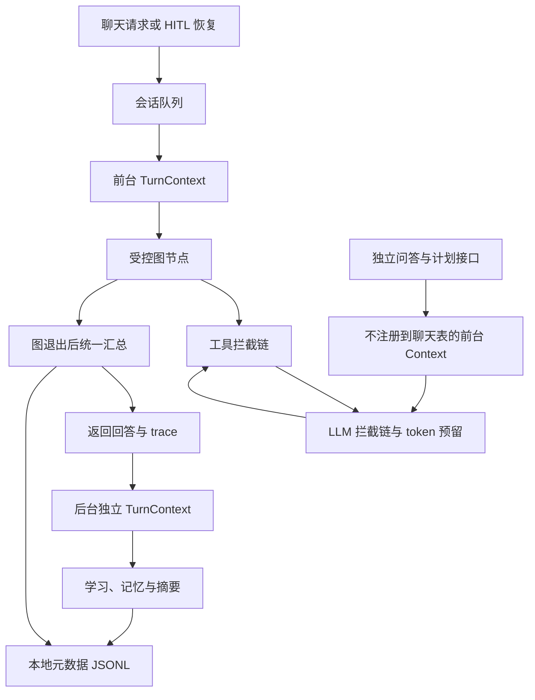

# Harness 运行控制设计

## 目标与边界

沿用独立于 ChatState 的预算和拦截器，统一管理每次执行的用量、停止、策略和诊断。智能体可以修改计划、重试次数和业务状态，不能通过重置这些字段恢复已经消耗的 harness 预算。

控制范围包括主聊天图、独立知识库问答、独立计划接口、后台学习和文档摘要。聊天排队等待时间不计入图执行预算；等待用户确认也不占用预算，确认请求建立新的一轮执行。



## 默认额度

| 维度 | 前台一次执行 | 后台一个任务 |
| --- | --- | --- |
| 截止时间 | 120 秒 | 90 秒 |
| LLM 调用次数 | 20 | 8 |
| 工具调用次数 | 25 | 0（后台直接调用业务函数） |
| token 预算扣量上限 | 120,000 | 40,000 |
| 每次模型输出上限 | 4,096 tokens | 4,096 tokens |

聊天图另有 40 个超级步的 LangGraph 限制。后台学习在一个线程池中串行处理，文档摘要使用另一个单工作线程池；二者各自有每任务预算，不会扣减正在进行的聊天额度。

移除了旧的“四次循环后转闲聊”限制，避免把正常的多步骤计划截断。预算耗尽会直接进入收口，不继续遍历剩余计划或重试分支。

这些是每次执行的额度，不是整天、整个会话或整个平台的总额度。

## 上下文隔离

`ContextVar` 是当前执行的首选上下文，能通过 `asyncio.to_thread` 传入同步节点。原有按 session_id 的注册表保留，作为聊天执行和旧调用方式的兼容入口。

后台与独立 API 不覆盖聊天注册表。即使用户同时聊天、检索文档并触发学习，各个任务也使用各自的 budget 和 turn_id。后台学习的 parent_turn_id 指向触发它的聊天执行，便于关联开销。

生产后台路径已不再使用 `budget_bypass()`。该接口仅保留给受信任的维护代码和旧接口兼容。

## 调用生命周期

所有实际 LLM 和图工具调用通过 `InterceptorChain.invoke()`：

1. 按顺序执行 before，包括预算检查与工具策略。
2. 执行实际操作，成功后逆序执行 after。
3. 无论在哪一步退出，finally 都补齐一次调用记录。

调用状态包括 success、error、blocked、cancelled、budget_exceeded。记录包含 call_id、parent_call_id、相对开始时间、耗时、错误类型与用量。父工具的耗时包含其内部 LLM 耗时，不能把所有嵌套调用耗时简单相加当作整轮耗时。

success 表示函数执行完成；业务结果是否正确仍由 verify、quality_gate 和业务校验判断。策略拒绝不直接判定整轮失败，预算耗尽则终止后续工作。

`harness_summary` 在图入口退出前统一生成，覆盖 quality_gate、主动建议和 HITL 挂起路径。调用失败时仍保留已经完成的节点轨迹，预算不会因业务重试而清零。

## token 统计与控制

发请求前使用消息 JSON 的 UTF-8 字节数加封装余量，保守估算输入额度，再预留本次允许的最大输出额度。输出上限取调用方要求、单次配置和剩余预算中的较小值。额度不足时不会发送请求。

- 服务返回有效 usage：记录实际 prompt_tokens、completion_tokens，并按实际总量结算。
- 没有 usage 或请求发出后异常退出：扣除完整预留量，标记 usage_source=reservation。
- 请求尚未发出就失败：释放预留量，标记 not_sent。

charged_tokens 是预算扣量，不等于服务商账单。prompt_tokens/completion_tokens 只汇总已经报告的实际值，必须结合 usage_missing_calls 阅读；缺失用量不会被算成实际零消费。如果提供方实际报告值超过预留和总额度，会保留真实数值并停止后续执行。

流式 usage 请求默认关闭，以兼容不同模型服务；确认服务支持后可启用 LLM_STREAM_INCLUDE_USAGE。即使流式没有 usage，保守预算仍然生效。此实现未配置模型单价，不虚构金额。

## 截止与取消

异步聊天图使用整轮超时上下文。达到截止时间或点击停止时，停止后续调用，等待已经运行的同步节点退出，并在数据库提交、学习文件替换、模型请求和流式读取等边界检查状态。

同步 Python 线程无法安全地强制终止，因此真实返回时间可能超过截止时间，尤其是在外部调用仍未退出时。模型请求关闭隐式重试，并使用剩余时间约束单次超时。独立同步 API 与后台任务在受控调用和写入边界协作停止。

停止前已经提交的操作不会回滚；没有提供外部副作用的 exactly-once 保证。与整轮截止无关的 TimeoutError 会保留为真实操作错误，不伪装成预算耗尽。

## 诊断保存

默认保存到 `app/data/harness/YYYY-MM-DD.jsonl`。每条记录有 turn_id、phase、operation、用户标识的哈希、状态、预算和调用元数据，不保存对话正文、模型输出、SQL、工具参数、API Key 或原始错误消息。

审计写失败只写告警，不阻断回答；上下文依然清理。每轮调用记录最多保留 200 条，防止异常链路无限增加诊断数据。

## 配置

```ini
CHAT_TURN_DEADLINE_SECONDS=120
CHAT_TURN_MAX_LLM_CALLS=20
CHAT_TURN_MAX_TOOL_CALLS=25
CHAT_TURN_RECURSION_LIMIT=40
CHAT_TURN_MAX_TOKENS=120000
LLM_MAX_OUTPUT_TOKENS=4096
LLM_STREAM_INCLUDE_USAGE=false
BACKGROUND_DEADLINE_SECONDS=90
BACKGROUND_MAX_LLM_CALLS=8
BACKGROUND_MAX_TOKENS=40000
# HARNESS_TRACE_DIR=E:\work\LifeOps-Agent\app\data\harness
```

文档摘要达到后台预算时，已经提交的摘要保留，剩余文件仍可用正文检索；预过滤不会排除尚未生成摘要的文件。下次执行索引可继续处理缺少摘要的文件。

## 验证

最终验证：全套 281 项测试通过；Python 编译检查及前端 JavaScript 语法检查通过。

`tests/test_harness_runtime.py` 使用模拟模型响应验证真实 LLM 包装器，包括 usage 结算、预留释放、流式关闭、调用父子关系、所有异常出口、前后台隔离、图截止、写入边界和独立 API。

另有原有 budget、SQL scope、图回归及后台文档摘要进度测试。测试不调用真实模型或发送真实通知。
